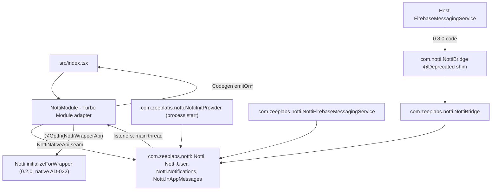

# Android on the Native SDK Design

**Spec**: `.specs/features/android-native-sdk/spec.md`
**Context**: `.specs/features/android-native-sdk/context.md` (G1-G3, decided 2026-11-04)
**Status**: Approved (Julio, 2026-11-04; decisions at the end)

---

## Architecture Overview

`NottiModule` shrinks from the owner of a `NottiCore` to an adapter: it maps each Codegen call to the public
API of `br.com.zeeplabs:notti-android` 0.2.0 and maps the SDK's listeners to the Codegen event emitters.
Everything below it (HTTP, retry, queues, stores, FCM service, process-start provider, click detection,
permission Activity, In-App engine and views) comes from the AAR.



No build spike was run for this design (unlike iOS). Facts below come from reading both codebases at
RN `docs/android-native-sdk-spec` (`50f7813`) and native `main` (`f4853ca`, 0.2.0). What only a build or
a device proves is marked and goes to Tasks (T1 spike, device checklist).

---

## Code Reuse Analysis

| Component | Location | How to use |
| --- | --- | --- |
| Codegen spec | `src/NativeNotti.ts` | Unchanged (no JS API change) |
| Native public API | `zeep-notti-android-sdk/notti/api/notti.api` | Every adapter call; signatures quoted below |
| Native wrapper entry | `Notti.initializeForWrapper` (`Notti.kt:58-70`) | `initialize` (ANSDK-03) |
| Native `NottiBridge` | `com.zeeplabs.notti.NottiBridge` (`NottiBridge.kt:22-34`) | Target of the shim (ANSDK-11) |
| `NottiPackage` | `android/src/main/java/com/notti/NottiPackage.kt` | Kept as is |
| Test helpers | `FakeReactApplicationContext` (`NottiModuleTest.kt:380`), `ShadowArguments` (`NottiActivityLifecycleListenerTest.kt:553`) | Moved to `NottiTestSupport.kt`; the second file is deleted |

### File fate (ANSDK-01, ANSDK-17)

`android/src/main/java/com/notti/` (23 files):

| File | Fate |
| --- | --- |
| `NottiModule.kt` | **Rewritten** as the adapter (`NottiModule` + `NottiAdapter`) |
| new `NottiNativeApi.kt` | Seam and adapter value types (OQ-4) |
| `NottiPackage.kt` | **Kept**, unchanged |
| `NottiBridge.kt` | **Rewritten** as the `@Deprecated` forwarding shim |
| `NottiActivityLifecycleListener.kt`, `NottiApiClient.kt`, `NottiCore.kt`, `NottiDeviceStore.kt`, `NottiEventStore.kt`, `NottiFirebaseMessagingService.kt`, `NottiInAppAccessibility.kt`, `NottiInAppCoordinator.kt`, `NottiInAppEventStore.kt`, `NottiInAppImageLoader.kt`, `NottiInAppModels.kt`, `NottiInAppPresenter.kt`, `NottiInAppSession.kt`, `NottiInAppSetup.kt`, `NottiInAppStyle.kt`, `NottiInAppViewFactory.kt`, `NottiInitProvider.kt`, `NottiNetworkObserver.kt`, `NottiNotificationClickRelay.kt`, `NottiPushPermissionAction.kt` | **Deleted** (20 files; ported 1:1 into `com.zeeplabs.notti`, native AD-002) |

`android/src/main/AndroidManifest.xml`: **emptied** to `<manifest />` (provider, service and
`POST_NOTIFICATIONS` now merge from the AAR; file kept for tooling).

`android/src/test/java/com/notti/` (20 files):

| File | Fate |
| --- | --- |
| `NottiModuleTest.kt` | **Rewritten**: module wiring (delegation to `NottiAdapter`, package) |
| new `NottiAdapterTest.kt` | Adapter tests (see Test plan) |
| `NottiBridgeTest.kt` | **Rewritten**: shim tests |
| new `NottiTestSupport.kt` | `FakeReactApplicationContext`, `ShadowArguments`, `FakeNottiNativeApi`, capturing event sink |
| `NottiActivityLifecycleListenerTest.kt`, `NottiApiClientTest.kt`, `NottiCoreTest.kt`, `NottiDeviceStoreTest.kt`, `NottiEventStoreTest.kt`, `NottiFirebaseMessagingServiceTest.kt`, `NottiForegroundObserverTest.kt`, `NottiInAppCoordinatorTest.kt`, `NottiInAppEndToEndTest.kt`, `NottiInAppEventStoreTest.kt`, `NottiInAppImageLoaderTest.kt`, `NottiInAppModelsTest.kt`, `NottiInAppPresenterTest.kt`, `NottiInAppSessionTest.kt`, `NottiInAppStyleTest.kt`, `NottiInAppViewFactoryTest.kt`, `NottiNetworkObserverTest.kt`, `NottiPushPermissionActionTest.kt` | **Deleted** (18 files; their ports run in the native repo's CI) |

---

## Components

### NottiModule (adapter)

- **Purpose**: map the Codegen spec to the native facade and native listeners to Codegen emitters. No
  business logic, no executors, no `SharedPreferences`, no companion statics.
- **Location**: `android/src/main/java/com/notti/NottiModule.kt`.
- **Constructor**: `NottiModule(reactContext, native: NottiNativeApi = DefaultNottiNativeApi)`.
  `NottiPackage` keeps calling `NottiModule(reactContext)`.
- **Seam** `internal interface NottiNativeApi`: one method per native call below, listener adders returning
  `NottiSubscription`-like handles, and adapter-owned value types (`NativeNotification(title, body, data)`,
  `NativeInAppClick(messageId, buttonId, actionType: NottiInAppAction.Type?, actionValue)`).
  Reason: the native value classes have `internal` constructors (`NottiNotification.kt:10`,
  `NottiInAppClick.kt:11`, `NottiInAppAction.kt:11`) and the facade is static, so tests cannot build or
  fake them; `NottiRuntime.setForTest` is `internal` (`NottiRuntime.kt:201`). `DefaultNottiNativeApi`
  is the only code that touches `Notti.*` and converts native values to the adapter types (one line each).
- **Event sink**: `internal var events: NottiEventSink` defaulting to the generated `emitOn*` methods, so
  tests capture payloads (same reason as 0.8.0 `inAppClickEmitter`, `NottiModule.kt:207-211`).
- **Staging** (Tasks): the mapping and lifecycle live in `internal class NottiAdapter(native, events)` in
  `NottiModule.kt`; `NottiModule` delegates every Spec method and `invalidate` to it. This lets the adapter
  be built and tested next to the old core (T3, T4) and keeps the core swap (T6) a small commit.

#### Method mapping (ANSDK-02, ANSDK-03, ANSDK-04)

Native signatures from `notti.api`. Threading: `getDeviceId` is synchronous on the JS thread; the void and
Promise methods run on the Turbo Module call thread; the facade accepts any thread (`Notti.kt` KDoc) and
posts callbacks and listeners to the main thread (`NottiListeners.kt:86-101`, `Notti.kt:256-259`).

| `NativeNotti.ts` | 0.8.0 (`NottiModule.kt`) | Adapter call | Null/empty handling |
| --- | --- | --- | --- |
| `initialize(appId, clientKey, baseUrl, sdkVersion)` | `:213-226`, `orEmpty()` on all, core logs invalid input | `@OptIn(NottiWrapperApi::class) Notti.initializeForWrapper(ctx.applicationContext, appId.orEmpty(), clientKey.orEmpty(), NottiOptions(baseUrl, opensInAppUrls = false), "react-native", sdkVersion)` - `(Context, String?, String?, NottiOptions?, String?, String?)V`; `NottiOptions(String?, Boolean)` exists (`<init>(Ljava/lang/String;Z)V`) | Blank id/key or invalid URL: native logs and ignores, previous valid config stays (`Notti.kt:30-35`), as 0.8.0. JS always sends a URL (`index.tsx:93`) |
| `requestPermission(): Promise<boolean>` | `:255-257` | `Notti.Notifications.requestPermission { promise.resolve(it) }` - `(NottiPermissionCallback)V` | Never rejects (0.8.0 never did). `false` before `initialize` (0.8.0 `NottiCore.kt:745-750`, same) |
| `login(id)` | `:259-261`, `?.let` | `Notti.login(id)` | Null: no call (keeps 0.8.0 silence; native would log) |
| `logout()` | `:263-265` | `Notti.logout()` | - |
| `addTags(map)` | `:267-279`, drops non-string values | `Notti.User.addTags(filtered)` - `(Map)V` | Keep the 0.8.0 filter verbatim. Null map -> `emptyMap()`; empty map reaches the same ported `mutateTags` as 0.8.0 (one PATCH with the unchanged merge) |
| `removeTags(keys)` | `:281-284`, `map { it.toString() }` | `Notti.User.removeTags(list)` - `(List)V` | Same mapping; null -> `emptyList()` |
| `setSubscription(b)` | `:286-288` | `Notti.setSubscription(b)` | - |
| `setLocationSharingEnabled(b)` | `:306-308` | `Notti.setLocationSharingEnabled(b)` | - |
| `setEmail(e)` / `clearEmail()` | `:290-296` | `Notti.User.setEmail(e)` / `clearEmail()` | Null: no call |
| `setPhone(p)` / `clearPhone()` | `:298-304` | `Notti.User.setPhone(p)` / `clearPhone()` | Null: no call |
| `getDeviceId(): string \| null` | `:310`, reads prefs | `Notti.deviceId` (`getDeviceId()Ljava/lang/String;`) | `null` until registered; also `null` with no runtime (see Behavior differences 1) |
| `trackEvent(name)` | `:313-315` | `Notti.trackEvent(name)` | Null: no call |
| `getInitialNotificationClick()` | `:325-328`, `takePending()` | `Notti.Notifications.takeInitialClick()` -> map or `null` | Resolves `null` when none; consumed once |

The 0.8.0 eager `getSharedPreferences` (`:66`) is not needed: the native provider opens `notti_prefs` at
process start (`NottiRuntime.kt:187-192`), so `getDeviceId` reads a loaded file.

#### Event mapping (ANSDK-05)

| Native listener (`notti.api`) | JS event | Payload |
| --- | --- | --- |
| `Notti.Notifications.addReceivedListener(NottiNotificationListener)` | `onNotificationReceived` | `{title, body, data}`; `putString` with `null` for a missing title/body, `data` always a map. Same as 0.8.0 `ParsedNotification.toWritableMap` (`NottiFirebaseMessagingService.kt:17-25`); native builds it with the ported `parseRemoteMessage` |
| `Notti.Notifications.addClickedListener(...)` | `onNotificationClicked` | Same shape; native uses the ported `parseClickIntentExtras` (title/body fall back to `data.title`/`data.body`, 0.8.0 `NottiActivityLifecycleListener.kt:37-61`) |
| `Notti.addDeviceIdChangedListener(NottiDeviceIdListener)` | `onDeviceIdChanged` | The id string |
| `Notti.InAppMessages.addClickListener(NottiInAppClickListener)` | `onInAppMessageClicked` | `{messageId, buttonId, action}`; `action` key always present (`putNull`), as 0.8.0 `NottiModule.kt:690-704` |

`NottiInAppAction.Type` -> 0.8.0 type string (0.8.0 only ever emitted these two, `NottiInAppModels.kt:153-162`):

| Native | JS `action.type` |
| --- | --- |
| `Type.URL` | `"url"` |
| `Type.DEEPLINK` | `"deeplink"` |
| any later enum value (native AD-018 allows additions in a minor) | `action: null` (OQ-3) |
| `push_permission` button | native already delivers `action == null` (`NottiInAppAction.kt:25-30`, `NottiInAppClick.kt` KDoc) -> JS `action: null`, as 0.8.0 `NottiInAppCoordinator.kt:213-216` |

`buttonId` is `"image"` for the image in both (0.8.0 `NottiInAppViewFactory.kt:740`, native KDoc).
In-App clicks are delivered synchronously on the main thread (`NottiInAppClicks.kt:15`); with no live
module the SDK logs the same no-listener warning as 0.8.0 (`NottiInAppCoordinator.kt:134`).

#### Listener lifecycle (ANSDK-06)

1. The module's last `init` statement adds the four listeners and keeps the four `NottiSubscription`s
   (0.8.0 also published itself last, `NottiModule.kt:170-173`).
2. `invalidate()` calls `remove()` on each (idempotent, `NottiSubscription.kt`), then `super.invalidate()`.
   A removed entry is nulled before the lock, so a delivery already posted to main does not reach it
   (`NottiListeners.kt:52-57`, `:91-92`): no emit into a torn-down module.
3. A new module instance adds its own four; each event reaches it once. No process-wide statics remain in
   RN, so the 0.8.0 identity guards (`activeInstance`, `activeCore`) go away.

#### Initial click (ANSDK-07)

Facts: the native click relay is the 0.8.0 relay verbatim (`diff -w` shows only `internal`):
`attach` does not replay the pending tap, `emit` buffers only while no emitter is attached, `takePending`
clears. The SDK attaches the relay on the first clicked listener and detaches on the last removal
(`Notti.kt:239-244`).

Design: the adapter's clicked listener, added at construction, plays the role of 0.8.0's
`NottiNotificationClickRelay.attach(clickEmitter)`; `getInitialNotificationClick` calls
`takeInitialClick()`. Cold start: the provider sees the tap before the module exists -> pending ->
module attaches (no replay) -> JS pulls it once. Between `invalidate` and the next module, taps are
buffered, as in 0.8.0. Unlike iOS, no "take, then listen" step is needed (the Android SDK never replays a
click to a new listener). Caveat: a host that also adds a native clicked listener (two engines) keeps the
relay attached and `getInitialNotificationClick` resolves `null`; README says one engine per app.

### `com.notti.NottiBridge` shim (ANSDK-11, G2)

0.8.0 public surface (`NottiBridge.kt:21-34`): `object NottiBridge` with `@JvmStatic fun
onMessageReceived(remoteMessage: RemoteMessage)` and `@JvmStatic fun onNewToken(token: String)`.

```kotlin
@Deprecated("Use com.zeeplabs.notti.NottiBridge", ReplaceWith("NottiBridge", "com.zeeplabs.notti.NottiBridge"))
object NottiBridge {
    @Deprecated(...) @JvmStatic
    fun onMessageReceived(remoteMessage: RemoteMessage) = com.zeeplabs.notti.NottiBridge.onMessageReceived(remoteMessage)

    @Deprecated(...) @JvmStatic
    fun onNewToken(token: String) = com.zeeplabs.notti.NottiBridge.onNewToken(token)
}
```

Same JVM signatures, so Kotlin and Java host services compile unchanged (deprecation warning only).
Behavior delta: 0.8.0's bridge only emitted the JS event; native also enqueues the `received` CTR event
(`NottiFirebaseMessagingService.kt` native `deliverRemoteMessage`). Hosts with their own service start
reporting `received`: upgrade note (fix, not regression). The `ReplaceWith` is only usable if the host can
see `com.zeeplabs.notti` at compile time, hence `api` (OQ-1).

### Manifest and components (ANSDK-12)

| 0.8.0 (`android/src/main/AndroidManifest.xml`) | 0.9.0 (from the AAR) |
| --- | --- |
| provider `com.notti.NottiInitProvider`, authority `${applicationId}.nottiinitprovider` | `com.zeeplabs.notti.NottiInitProvider`, authority `${applicationId}.com.zeeplabs.notti.initprovider` |
| service `com.notti.NottiFirebaseMessagingService` (`MESSAGING_EVENT`) | `com.zeeplabs.notti.NottiFirebaseMessagingService` |
| permission dialog via host `PermissionAwareActivity` | new activity `com.zeeplabs.notti.NottiPermissionActivity` (translucent, not exported) |
| `POST_NOTIFICATIONS` | same, from the AAR |

Native classes are `internal` in Kotlin but public in bytecode; `tools:node="remove"` matches by name, so
it works with the new names. Integrator change: replace `com.notti.NottiFirebaseMessagingService` /
`com.notti.NottiInitProvider` in `tools:node="remove"` entries with the `com.zeeplabs.notti` names. An old
entry no longer matches anything and the native service is merged next to the host's own (risk R1).

### Gradle (ANSDK-01, ANSDK-15, ANSDK-16)

`android/build.gradle` dependencies become:

```groovy
implementation "com.facebook.react:react-android"
api "br.com.zeeplabs:notti-android:0.2.0"   // OQ-1: api, OQ-2: exact pin (Decisions)

testImplementation "junit:junit:4.13.2"
testImplementation "org.robolectric:robolectric:4.14.1"
```

Removed: `firebase-messaging:25.1.2` (native exposes it as `api`, same version, and the shim's
`RemoteMessage` compiles against it), `lifecycle-process`, `mockwebserver`, `okhttp-tls`, `org.json`.
`namespace "com.notti"`, `minSdkVersion` 24, `compileSdkVersion` 36 and the `kotlinVersion` 2.0.21
default stay. No repository line: the artifact is on Maven Central, which RN and Expo projects already
resolve [Provável; T1 spike proves it on the example].

**Pin**: exact `0.2.0`, not `0.2.+`. Dynamic versions make builds non-reproducible, and Gradle's default
conflict resolution already lets a host raise it to a later 0.2.x by declaring it. Each RN release picks
the native version on purpose (same rule as iOS `~> 0.2.0`, which CocoaPods enforces; Gradle cannot
express a patch-only range without dynamic versions).

**Floors** (native README Requirements, native AD-017):

| Floor | Native 0.2.0 | 0.8.0 lib | Effective host RN |
| --- | --- | --- | --- |
| `minSdk` | 24 | 24 | unchanged |
| `compileSdk` | `minCompileSdk` 34 | 36 default | RN >= 0.74 already |
| Kotlin | stdlib 2.0.21, metadata 2.0 | KGP of the host | Host Kotlin >= 2.0 -> RN >= 0.77 [Provável]; example is RN 0.87.1 / Kotlin 2.1.20 |
| `firebase-messaging` | `api` 25.1.2 | `implementation` 25.1.2 | One version; Gradle picks the highest if the host (e.g. RN Firebase BoM) has a newer one |
| AGP | AAR built with AGP 9.2.1 | - | Hosts on AGP 8.x consume it [Provável; T1 spike] |

`package.json` declares `react-native: "*"`, so no RN floor is documented today. The Codegen spec already
uses the `CodegenTypes` namespace, which may set a higher real floor [Incerto]. README Requirements must
state the higher of the two (OQ-5).

No duplicate classes: RN keeps only `com.notti.{NottiModule, NottiPackage, NottiBridge}` and generated
`com.notti.NativeNottiSpec`; native is `com.zeeplabs.notti` (native AD-003, `check-package-name.sh`).

### Expo config plugin (ANSDK-13)

Verified in `plugin/src/withNotti.ts`: the Android part applies the Google Services class path, plugin
and file (`:24-31`) and writes the FCM default notification icon/color meta-data and color resource
(`:137-172`). It references no `com.notti` class and no manifest component. **No change.** Expo SDKs
whose Kotlin is below 2.0 cannot take 0.9.0 (same floor as above).

---

## Data continuity (ANSDK-08..10)

Key audit (2026-11-04): `grep -ohE '"notti_[a-z0-9_]+"'` over RN `android/src/main/java/com/notti/*.kt`
and native `notti/src/main/java/com/zeeplabs/notti/*.kt`.

- File: both use `notti_prefs`, `MODE_PRIVATE` (RN `NottiModule.kt:560`, native `NottiRuntime.kt:181`).
- RN 0.8.0 keys (32 + tag prefix): `notti_app_version`, `notti_device_id`, `notti_email`,
  `notti_external_user_id`, `notti_first_session_at_ms`, `notti_last_foreground_at_ms`,
  `notti_last_session_at_ms`, `notti_last_synced_country`, `notti_last_synced_device_model`,
  `notti_last_synced_device_os`, `notti_last_synced_email`, `notti_last_synced_language`,
  `notti_last_synced_permission_status`, `notti_last_synced_phone`, `notti_last_synced_sdk_version`,
  `notti_last_synced_timezone_id`, `notti_last_token`, `notti_last_unsubscribed_at_ms`,
  `notti_location_sharing_enabled`, `notti_pending_country_clear`, `notti_pending_events`,
  `notti_pending_external_user_id_clear`, `notti_pending_inapp_events`,
  `notti_pending_permission_unsubscribe_at_ms`, `notti_pending_unsubscribe_at_ms`,
  `notti_permission_requested`, `notti_phone`, `notti_profile_field_ack_migrated`, `notti_session_count`,
  `notti_session_started_at_ms`, `notti_session_time_ms`, `notti_subscribed`, prefix `notti_tag_`.
- Native 0.2.0 reads and writes **every one** of them. Only addition: `notti_last_synced_sdk_name`.
- Types: the `get*/put*` accessor sets of `NottiDeviceStore`, `NottiEventStore` and
  `NottiInAppEventStore` are identical except the new key. `NottiEventStore.kt` and
  `NottiInAppEventStore.kt` differ from RN only by `internal` and one comment (`diff -w`), so the JSON
  record schemas of `notti_pending_events` and `notti_pending_inapp_events` (with their `app_id`) are the
  same. No key is ignored, no type mismatch, no migration code.

Consequences: the same `notti_device_id`/`notti_last_token` mean no new device row (ANSDK-08); queued
push events, In-App events and the pending `external_user_id` clear are flushed by the same ported core
(ANSDK-09). `notti_last_synced_sdk_version` holds `0.8.0`, so the first launch sends one profile PATCH with
`0.9.0`; `notti_last_synced_sdk_name` is absent, so `sdk_name: "react-native"` is sent once (additive).
Proof on a device: D-check "0.8.0 install, register, add tags, upgrade in place" (spec Independent Test).

---

## Behavior differences (upgrade notes, ANSDK-14)

Each verified against code:

1. **Identity calls before `initialize`.** 0.8.0: every mutation (`login`, `logout` PATCH, tags,
   `setSubscription`, email/phone PATCH) logs `called before initialize - ignored` and is dropped
   (`NottiCore.kt:1092-1100`); local state is still written (held email/phone `NottiCore.kt:944-949`,
   logout clear flag, location flag); `requestPermission` resolves `false` (`:745-750`); `getDeviceId`
   reads prefs. 0.9.0 with the provider in place (default): **identical**, the native runtime exists from
   process start and runs the same ported core. 0.9.0 when the host removed the provider and before the
   first `initialize`: the whole call is dropped with one `WARN` line, local state included, and
   `getDeviceId` is `null` (`Notti.kt:370-385`, native AD-008). The spec's edge case is narrower than
   written: it only affects hosts that remove the provider.
2. **Permission dialog only in the foreground**: otherwise `requestPermission` resolves `false` without
   setting `notti_permission_requested` (native AD-019(2), `NottiPermissionRequester.kt:60-66`). 0.8.0
   prompted from any `PermissionAwareActivity`.
3. **Dialog runs in `NottiPermissionActivity`**, not the host Activity (0.8.0 `NottiModule.kt:528-556`).
   RN's `PermissionAwareActivity` listener registry is no longer involved.
4. **Malformed tap Intents no longer crash the host** (native AD-019(3), native
   `NottiActivityLifecycleListener.kt:154`).
5. **Provider authority and component class names change** (Manifest table above).
6. **`com.notti.NottiBridge` is deprecated** and `onMessageReceived` now also reports `received`.
7. **One process-wide core**: 0.8.0 built a new core per module instance (`NottiModule.kt:110-146`);
   native keeps one (`NottiRuntime.ensureCore`) and an equal `initialize` is a no-op, so a dev reload no
   longer re-runs registration [Provável; confirm on device]. Not integrator-visible in release builds.
8. **`sdk_name: "react-native"`** is a new profile field (needs a backend that accepts it; native README
   lists the version).
9. Not visible to JS: received and device-id events are posted to the main thread before emission
   (0.8.0 emitted from the FCM/IO thread).

---

## Error Handling Strategy

| Scenario | Handling | Integrator impact |
| --- | --- | --- |
| Invalid `initialize` values | Native logs without values, ignores, keeps previous config | Same as 0.8.0 |
| Identity call before `initialize`, provider present | Ported core logs and drops the PATCH | Same as 0.8.0 |
| Identity call before `initialize`, provider removed | Native `WARN`, dropped | Upgrade note |
| Old `tools:node="remove"` on `com.notti.*` | Removal matches nothing; native service merged | Two `MESSAGING_EVENT` services; upgrade note (R1) |
| Host on Kotlin < 2.0 | Compile error reading 2.0 metadata / stdlib | README floor |
| Native listener throws | Native catches per listener, logs class only (`NottiListeners.kt:93-97`) | None |
| Emit after invalidate | Subscription removed first; nothing emitted | None |

---

## Test plan (ANSDK-17, ANSDK-18)

JUnit 4 + Robolectric (`@Config(sdk = [34])`, `ShadowArguments` for `Arguments.createMap`). The module is
built with `FakeReactApplicationContext` and a `FakeNottiNativeApi` that records calls and holds the
listeners it was given; a capturing `NottiEventSink` records emitted maps. Per L-001, these tests prove the
adapter's own mapping and lifecycle; SDK behavior is proven in the native repo.

| Test | Requirement |
| --- | --- |
| `initialize` calls the wrapper entry with `sdkName = "react-native"`, the given `sdkVersion`, `baseUrl`, `opensInAppUrls = false`; never the plain `initialize` | ANSDK-03, ANSDK-04 |
| Each void method forwards its arguments once (table-driven); `addTags` drops non-string values; null arguments make no call | ANSDK-02 |
| `requestPermission` resolves the native result (`true`/`false`), never rejects | ANSDK-02 |
| `getDeviceId` returns the native value and `null` | ANSDK-02 |
| `getInitialNotificationClick` resolves the mapped payload, then `null` | ANSDK-07 |
| Received/clicked payload: `title`/`body` keys present with `null`, `data` copied | ANSDK-05 |
| In-App payload: `URL`->`"url"`, `DEEPLINK`->`"deeplink"`, null action -> `action` key present with `null`; every `NottiInAppAction.Type.entries` value has an explicit mapping (fails when native adds one) | ANSDK-05 |
| Construction adds exactly 4 listeners; `invalidate` removes all 4; an event fired after `invalidate` is not emitted; a second module receives each event once | ANSDK-06 |
| Shim forwards both calls (seam inside the shim, or no-throw with no runtime as in 0.8.0 `NottiBridgeTest`) and carries `@Deprecated` | ANSDK-11 |

Build-level checks (Tasks):

- `example/android: ./gradlew :app:dependencies --configuration releaseRuntimeClasspath` shows one
  `firebase-messaging` and `br.com.zeeplabs:notti-android:0.2.0` (ANSDK-16).
- A script check that `android/src/main/java/com/notti/` holds only the adapter files (ANSDK-01).
- Gates (ANSDK-18): `pnpm typecheck && pnpm lint && pnpm test`, `pnpm turbo run build:android`,
  `pnpm turbo run build:ios`, and `example/android: ./gradlew :react-native-notti:testDebugUnitTest`
  (CI `ci.yml:111-114`). Test count drops (18 suites deleted); that is the point of the feature, stated in
  the PR.
- Device checklist: in-place upgrade 0.8.0 -> 0.9.0 (one device row, same id, tags intact), cold-start
  tap via `getInitialNotificationClick`, warm tap event, In-App `url`/`deeplink`/`push_permission` clicks,
  permission prompt foreground/background, and a host variant with its own FCM service using the shim and
  the new `tools:node="remove"` names (the example has no such service today).

---

## Tech Decisions

| Decision | Choice | Rationale |
| --- | --- | --- |
| Wrapper identity | `Notti.initializeForWrapper` with `@OptIn(NottiWrapperApi::class)` | G1, native AD-022 |
| Link rule | `NottiOptions(baseUrl, opensInAppUrls = false)` | AD-004; native default is `true` |
| Test seam | `NottiNativeApi` + adapter value types | Static facade, `internal` constructors and test hooks in native |
| Initial click | Listener at construction + `takeInitialClick()` | Native relay = 0.8.0 relay, no replay on attach |
| Native dependency | `api`, exact `0.2.0` | OQ-1, OQ-2; reproducible builds, host may raise a patch |
| Shim | `@Deprecated` (WARNING), same JVM signatures | G2 |
| Release | 0.9.0 with iOS, `BREAKING CHANGE` | G3; manifest names and floors change |

---

## Risks

- **R1** Hosts with their own FCM service that removed `com.notti.NottiFirebaseMessagingService` get the
  native service merged next to theirs; Android routes `MESSAGING_EVENT` to one of them, so the host's
  service may stop receiving pushes. Mitigation: first item of the Android upgrade notes, README snippet
  with the new name, device check. [Certo] that the old removal stops matching; which service wins is
  [Incerto].
- **R2** Hosts on Kotlin < 2.0 (RN <= 0.76 [Provável]) cannot build 0.9.0. Mitigation: README floor,
  `BREAKING CHANGE`.
- **R3** AGP 9-built AAR on AGP 8 hosts and Maven Central resolution are unproven here. Mitigation: T1
  spike builds the example (RN 0.87.1) before the deletion tasks.
- **R4** Android behavior and timing now follow native releases; a host-side bump to 0.2.x changes RN
  behavior without an RN release. Accepted (AD-006 trade-off).

## Decisions (Julio, 2026-11-04)

All seven open questions were closed with the recommended option.

| ID | Question | Decision |
| --- | --- | --- |
| OQ-1 | `api` or `implementation` for `br.com.zeeplabs:notti-android` | **`api`**: hosts can follow the shim's `ReplaceWith` to `com.zeeplabs.notti.NottiBridge`. README adds "do not call `com.zeeplabs.notti.Notti` directly from an RN app" (a direct `Notti.initialize` would report `sdk_name: "android"`). |
| OQ-2 | Pin `0.2.0` or `0.2.+` | **Exact `0.2.0`** (reasons under Gradle). |
| OQ-3 | Future `NottiInAppAction.Type` value | **`action: null`** (JS consumers switch on `url`/`deeplink`; 0.8.0 dropped unknown types at parse). |
| OQ-4 | Seam location | **Separate `NottiNativeApi.kt`**; the spec's success criterion now reads "only adapter files (`NottiModule`, `NottiPackage`, the `NottiBridge` shim and the `NottiNativeApi` seam)". |
| OQ-5 | README RN floor | **Measure in T1** (Kotlin 2.0 floor vs the `CodegenTypes` floor) and document the higher one. |
| OQ-6 | Provider-removed hosts lose pre-`initialize` identity calls | **Accept and document** in the upgrade notes; no native change. |
| OQ-7 | Shim deprecation level | **`DeprecationLevel.WARNING`**; removal no earlier than 1.0. |

---

## Prerequisite outside this repo

`br.com.zeeplabs:notti-android` 0.2.0 with `initializeForWrapper` (native `wrapper-support`, AD-022):
tagged `0.2.0` and released 2026-11-04 (native `CHANGELOG.md`). Nothing else is needed from the native repo
for this feature.
