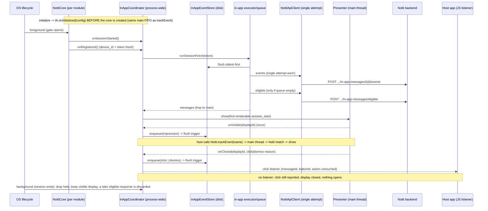
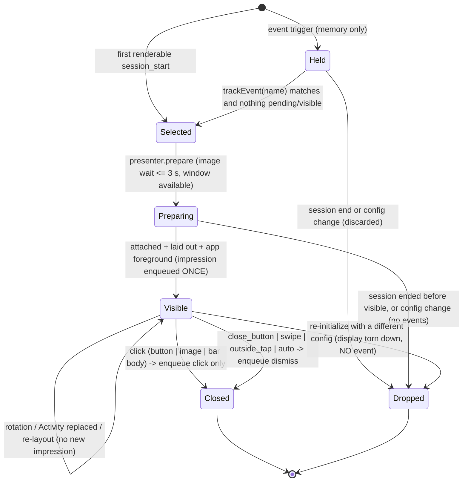

# In-App Messages Design

**Spec**: `.specs/features/in-app-messages/spec.md`
**Status**: Draft (written 2026-10-18, amended 2026-10-19 with the owner's review decisions; no code written; every `file:line` below was read in the working tree on 2026-10-18, package version 0.6.0)

Confidence tags: [Certo] verified in code or contract, [Provável] reasonable inference, [Incerto] needs a device or the owner.

---

## Architecture Overview

Three facts about the existing SDK drive the design:

1. **A "session" already exists and is process-wide.** Both platforms open a session on foreground through a `SessionGate` shared by every core of the process and close it on background, even when no core is alive: Android `NottiCore.SessionGate` (`NottiCore.kt:136`), opened at `NottiCore.kt:436`, closed in `NottiForegroundObserver.handleProcessBackground` (`NottiInitProvider.kt:140`, called from `onStop` at `:127`); iOS `NottiCore.SessionGate` (`NottiCore.swift:88`), opened at `NottiCore.swift:994`, closed by `NottiImpl.processBackgroundObserver` (`NottiImpl.swift:47`, always installed by `NottiImpl.init` at `:109`) and `handleAppDidEnterBackground` (`:1020`). In-App reuses exactly this boundary [Certo].
2. **The cores are disposable, the process is not.** An RN reload drops `NottiModule`/`NottiImpl`, their cores and (Android) their `ioExecutor` (`NottiModule.invalidate`, `NottiModule.kt:177`; `NottiImpl.invalidate`, `NottiImpl.swift:259`) while the app stays foregrounded. In-App state (held messages, shown set, the visible display) must therefore live in a **process-wide singleton**, like the process session gate and the CTR event store, never inside a core.
3. **The shared work queue blocks.** `NottiApiClient.executeWithRetry` sleeps on the caller's thread (`NottiApiClient.kt:267`, `sleeper(delayMs)` at `:310`; iOS `NottiApiClient.swift:242` over the blocking `syncDataTask` at `:319`) for up to 2+4+8+16 s per call, on the single `notti-io` executor (`NottiModule.kt:92`) / serial `app.notti.sdk.core` queue (`NottiCore.swift:116`). A stuck CTR event (documented in `STATE.md` "Known limitations") would delay `eligible` and impressions. In-App therefore runs on **its own serial executor/queue**, with a single-attempt HTTP primitive and scheduled (non-blocking) retries.

### Display state machine (per message, process-wide, main thread)

A response to `eligible` that arrives after its session ended (or after a config change) never enters this machine: it is discarded on arrival (`fetchGeneration` mismatch, see Session state). "Candidate queue" in the request maps to `Held` (event messages) plus the one `Selected` session-start message. Only the **first** renderable `session_start` message is shown; the other session-start messages in the response are not queued behind it (contract: "show the first ... right away"); they were never impressed, so the server offers them again next session [Provável: reading of the contract, flagged for the owner's eyes].

---

## Code Reuse Analysis

| Component | Location | How it is used |
| --- | --- | --- |
| Process session gate | `NottiCore.kt:136,436`, `NottiInitProvider.kt:127-143`; `NottiCore.swift:88,994,1034`, `NottiImpl.swift:32,47` | The session boundary for In-App (A5). New hooks call the coordinator at gate open and at gate close. |
| CTR event store pattern | `NottiEventStore.kt:54` (JSON array in `SharedPreferences`, static `LOCK` `:77`, corrupt-queue self-heal `:111`, cap `:65`); `NottiEventStore.swift:58` (`UserDefaults`, `NSLock`, cap `:60`, key `:61`) | Mirrored (not shared) by `NottiInAppEventStore`: same persistence style, same file/suite `notti_prefs`, own key `notti_pending_inapp_events`. |
| Process-wide singleton access | `NottiModule.getEventStore` (`NottiModule.kt:569`), `NottiImpl.eventStore` (`NottiImpl.swift:68`) | Same pattern for the coordinator: Android `NottiInApp.install(application)` from `NottiInitProvider.onCreate` (`:35`); iOS `static let` on `NottiImpl`. |
| Network-regained trigger | `NottiNetworkObserver.kt:32` (default lambda `activeCore?.onNetworkAvailable()`), `NottiNetworkObserver.swift:59` | Extended: the default callback also calls `coordinator.onNetworkAvailable()` (not through the core, so it works with no core). |
| Registration success hook | `NottiCore.kt:688-710` (`registerDevice` -> `flushEventQueue()` at `:710`); `NottiCore.swift:687-712` | One extra line after it: `inApp.onRegistered()`. |
| Initialize hook | the `initialize` path that creates the core (`NottiModule` on Android, `NottiImpl` on iOS; core creation is lazy and replays the missed foreground) [Provável: exact call sites to confirm in T13/T25] | One call before the core is created: `inApp.onInitialized(appId, clientKey, baseUrl)`, so the replayed `onSessionStarted()` always comes after it (A14, SDKIAM-70). |
| Foreground/background hooks | `NottiCore.kt:427-436,519`; `NottiCore.swift:972-1034` | `onSessionStarted()` at the successful `tryOpen`; `onSessionEnded()` at the always-on process observers. |
| Device identity | `NottiDeviceStore.getDeviceId()`/`getLastToken()` (`NottiDeviceStore.kt:96,102`), `NottiCore.getDeviceId()` (`NottiCore.kt:736`; `NottiCore.swift:571`) | Read at send time (like CTR: a token refresh between enqueue and flush must surface as the standard `403`, not as a stale frozen value). |
| URL building | `NottiApiClient.kt:199,212` (segment-by-segment `HttpUrl` builder, L1 note); `NottiApiClient.swift:137` (`percentEncodedPathComponent`) | New `in-app-messages/eligible` and `in-app-messages/{id}/events` paths built the same way. |
| Timestamps | `NottiCore.formatIsoUtc` (`NottiCore.kt:675`, `NottiCore.swift:1304`) | `occurred_at`. Extract to a top-level internal function in the coordinator task (behavior-preserving) rather than duplicating. |
| Retry constants | `NottiApiClient.kt:82` (5 attempts, 2 s base), `NottiApiClient.swift` `maxAttempts`/`baseDelayMs` | Same schedule (2, 4, 8, 16 s; 5 attempts) but executed as scheduled retries, not `Thread.sleep`. |
| Test infrastructure | `NottiApiClientTest.kt` (MockWebServer, injectable sleeper), Robolectric in 8 existing test classes (`android/build.gradle:67`), `StubURLProtocol.swift`, `NottiCoreTests.swift` per-test teardown of sessions | Reused. L-003: explicit `takeRequest` timeout everywhere. |
| NOT reused | `executeWithRetry` (both), `NottiEventStore` (both), `NottiCore.flushEventQueue` (`NottiCore.kt:1263`, `NottiCore.swift:1379`) | See DD-2 and DD-3. |

---

## Key design decisions

| ID | Decision | Rationale |
| --- | --- | --- |
| DD-1 | **Native only; two public JS additions.** `Notti.trackEvent(name)` -> Turbo Module -> coordinator; `Notti.InAppMessages.addClickListener(handler)` -> Codegen event emitter `onInAppMessageClicked`. No other callbacks (A8). | AD-001; the contract needs `trackEvent`, and the owner decision (A9) needs the click listener. Adding the method and the emitter makes Android's generated `NativeNottiSpec` require `trackEvent` and iOS' protocol a `trackEvent:` selector, so T1 adds explicit compile-compat no-ops that T13/T25 replace. |
| DD-2 | **Separate persisted queue** (`NottiInAppEventStore`), not the CTR queue. | The CTR queue is capped at 32 with drop-oldest (`NottiEventStore.kt:65`), stops at the first transient failure and blocks until evicted (`STATE.md` Known limitations: head-of-line blocking, no TTL, no `Retry-After`). In-App needs the opposite properties: a 7-day TTL, `Retry-After`, a flush that must be *empty* before `eligible`, `event_id`/`occurred_at` records, and events from a different endpoint with a different body. Sharing would let a stuck CTR event delay impressions (and therefore `eligible`) and let In-App events evict CTR events. Cost accepted: a second ~150-line store per platform, tested on both. |
| DD-3 | **In-App has its own executor/queue and a single-attempt HTTP primitive.** Retries are scheduled, not slept. | Avoids head-of-line blocking behind `notti-io`/the core queue (up to ~30 s per CTR attempt, 105 s on iOS' 15 s timeouts), lets `Retry-After` be honored without parking a thread, and keeps `executeWithRetry` untouched (it serves registration, every PATCH and CTR; changing it risks regressions across the SDK). New code reads the status, the body and `Retry-After`; it does not collapse everything to terminal/transient. |
| DD-4 | **Process-wide coordinator; all state transitions on the main thread.** Network work on the in-app executor; results hop to main. | One visible message, once-per-session and "impression exactly once" are easiest to guarantee with a single owner thread and no locks. `trackEvent` and `onInitialized` from the JS thread are posted to main through the same queue (FIFO preserves call order, so `initialize` immediately followed by `trackEvent` is seen in that order). The event store keeps its own lock because it is also read by the executor. |
| DD-5 | **Android presentation: an overlay `FrameLayout` added to the resumed Activity's content view** (`android.R.id.content`), moved between Activities by an activity tracker. **iOS: a dedicated `UIWindow`** in the active scene (or a screen-sized window for scene-less apps), not made key, with passthrough hit-testing for bars. | See "Presentation" and "Alternatives discarded". |
| DD-6 | **The impression is recorded by the coordinator state, not by the view.** The view only reports "attached and laid out"; a per-display `impressionRecorded` flag in the process-wide state decides. | Views are recreated by rotation/Activity changes; state is not (risk R1). |
| DD-7 | **Pure, injectable cores for everything testable without a window**: parser, style resolver, layout metrics, session state machine, display clock, event store, coordinator (ports: identity, clock, uuid, scheduler, presenter, http, click sink, image loader). | L-001/SDKIAM-66, and iOS' hostless test bundle cannot present windows or use `UIApplication.shared` (`NottiCoreTests.swift` workarounds, `STATE.md` T8 notes). |
| DD-8 | **A visible display survives the session end; the next session treats its id as shown and drops a `session_start` candidate that would stack on it.** Held event messages are discarded at session end. | The contract pauses the auto-dismiss timer "while in the background", which only makes sense if the display survives a background; discarding held messages and the once-per-session rule are session-scoped. The contract is silent on the combination (listed in the report as a gap). |
| DD-9 | **The SDK never opens a link; the click is always reported, closes the display without `dismiss`, and is emitted to the JS listener untouched (A9).** Order: `impression` already persisted -> `click` enqueued -> listener emit -> display closed. No listener: report, close, open nothing, one fixed warning, **no buffer**. | Owner decision; mirrors the iOS SDK (IAM-24..26). A buffer like `NottiEventBuffer`'s (`ios/NottiEventBuffer.swift`, `getInitialNotificationClick`) exists because a push tap can precede the JS bridge on a cold start; an In-App click needs a fetched, rendered and visible message, so the process is alive. Replaying it to a listener registered later would navigate at an unexpected moment. |
| DD-10 | **Android system Back: consumed on `center`/`full`, not intercepted on `top`/`bottom`; never a dismiss path** (A19, SDKIAM-22; replaces the earlier "back is not intercepted"). Mechanism (Android, owned by the presenter, not the view): while a `center`/`full` display is attached to a resumed Activity, the presenter registers an enabled no-op `OnBackPressedCallback` on `(activity as? ComponentActivity)?.onBackPressedDispatcher` (`ReactActivity` extends `AppCompatActivity`, so this is the normal case) and removes it when the overlay is detached or the display closes (pause, destroy, Activity change, click, dismiss, config-change teardown). On API 33+ AndroidX forwards an enabled callback to the platform `OnBackInvokedDispatcher` (`OnBackInvokedCallback`), which covers the predictive back and gesture-navigation path when the host opted in with `android:enableOnBackInvokedCallback`; if the Activity is not a `ComponentActivity`, the presenter registers an `OnBackInvokedCallback` with `PRIORITY_OVERLAY` directly on API 33+ and, below 33, handles `KEYCODE_BACK` through a key listener on the focusable overlay (`center`/`full` only). `top`/`bottom` register nothing. [Incerto: validate on a real device, including predictive back and gesture navigation, API 33/34/35 with and without the opt-in, and the React Native Back path (a `ReactActivity` that routes Back to the JS `BackHandler` before the dispatcher would still let the host react; see R17). Also verify in T10 that `androidx.activity` is on the library's compile classpath transitively through `react-android` and that no dependency has to be added for it.] | The contract's `reason` enum has no "back", so Back cannot dismiss (it would invent a reason or lie as `close_button`); but on a modal-like `center`/`full` message, letting Back navigate the host app behind it is the surprising behavior the owner rejected. On bars there is no backdrop and the app stays interactive, so Back keeps its normal job. The accessibility close control stays the only way out of `full`. |
| DD-11 | **`impression` is persisted on the main thread before the view is exposed to the user's first touch**: the enqueue is synchronous in the `onVisible` callback, `click`/`dismiss` are enqueued later by definition. | Guarantees ordering and survives a kill between display and tap. |
| DD-12 | **Default colors are semantic system colors; the SDK never derives or adjusts a color for contrast** (A13). With only `background_color` set the text keeps its semantic default. | Owner decision (replaces the earlier luminance-derivation proposal). Contrast is the author's responsibility; the server/dashboard only warn. |
| DD-13 | **`trackEvent` cold-start window: an engine flag `awaitingFirstSession`.** `onInitialized` sets it only when no session has opened yet in this process; the first `onSessionStarted` clears it. While it is set, `trackEvent` names are remembered in `pendingNames` (same 32-distinct cap, memory only) even though no session is open, and replayed once with the first session's held messages. Names before `initialize`, or while no session is open after a session already ran, are ignored with no log. [Provável: derived from the code reading below; validate the ordering on device, T30 scenario 25] | Verified in code on 2026-10-19: the core is created lazily on `initialize`, replays the missed foreground, and the store work behind the session start is dispatched asynchronously (Android); on iOS `didFinishLaunching` runs with `applicationState == .inactive`, so the session opens only at `didBecomeActive`. A `trackEvent` right after `initialize` therefore reached the engine before any session and was dropped by the old "no session open -> ignore" rule. The flag closes the window without reordering the existing lifecycle. |
| DD-14 | **Re-initialize: same config preserves, different config resets; queue records carry `app_id`.** `onInitialized` compares `(appId, clientKey, baseUrl)` with the last one seen in this process (in memory, never logged). Same: nothing changes (RN reload, A5). Different: `fetchGeneration` is incremented (an in-flight `eligible` response and any pending retry or wait are discarded), `held`, `pendingNames`, `fetch` (back to `Idle`), the `eligible`/events pause deadlines and the once-per-session warning flags are reset, `shownIds` of the old config is cleared, a visible or pending display is torn down through the `Presenter` WITHOUT enqueueing any event, and `NottiInAppEventStore.purgeOtherApps(appId)` removes records of other apps. The next registration under the new config triggers one `eligible`. Records carry `appId` and the flush sends only the current one. | The server routes are per app: a queued event of app A answers `404` against app B. Stale held messages or a stale 429 deadline from another app must not leak into the new config. A same-config re-initialize happens on every RN reload and must stay free. |

---

## Components

Both platforms keep the repo's flat layout (`android/src/main/java/com/notti/`, `ios/`). The podspec glob `ios/**/*.{h,m,mm,swift,cpp}` (`Notti.podspec:25`) picks new Swift files up; `ios/Tests/**` stays excluded (`Notti.podspec:25-31` area, `AGENTS.md` Known gotchas).

### Shared contract of the new types (illustrative shapes, not final code)

- `InAppMessage { id, format(top|center|bottom|full), title, body, imageUrl?, imageAction?: InAppAction, style: InAppStyle, dismissAfterSeconds?: Int, trigger: SessionStart | Event(name), buttons: [InAppButton(id, label, action)] }`
- `InAppAction { type: url|deeplink, value }` (value untouched; an unknown `type` yields no action: the click payload carries `action: null`).
- `InAppStyle { backgroundColor?, textColor?, buttonColor?, buttonTextColor?, textAlign: left|center|right, margin: Bool }` with parse failure of any color = `nil` (never throws).
- `InAppEvent { eventId, appId, messageId, type: impression|click|dismiss, buttonId?, reason?, occurredAtMs }` (`appId` = the app the event was created for, SDKIAM-44).
- `InAppConfig { appId, clientKey, baseUrl }`, compared by value on `onInitialized` (SDKIAM-70); never logged.
- `DisplayOutcome = Click(buttonId) | Dismiss(reason)`.
- `InAppClick { messageId, buttonId, action? }` delivered through a `ClickSink` port.
- Ports: `InAppIdentity() -> (client incl. appId, deviceId, token)?`, `Clock`, `UuidSource`, `Scheduler` (immediate/delayed work on the in-app executor), `Presenter`, `ClickSink`, `ImageLoader`.

### Android (Kotlin)

| New / changed file | What it does |
| --- | --- |
| `NottiInAppModels.kt` (new) | Models; `parseEligibleResponse(body)`: tolerant (unknown fields ignored, bad entries skipped, unknown `format` -> center, unknown trigger/action -> entry marked not renderable); `parseHexColor` (`#RRGGBB`, case-insensitive, otherwise `null`); renderability (SDKIAM-14): buttons kept only with non-empty `id` and `label` (first two valid ones), non-`https` `image_url` ignored, `image_action` without an image ignored. Uses `org.json`; bodies are built with explicit `JSONObject` values, never nested `Map`s (the AOSP `org.json` pitfall documented in the `buildPatchJson` comment in `NottiApiClient.kt`). |
| `NottiInAppEventStore.kt` (new) | Persisted queue (see "Event queue"), records carry `appId`; `purgeOtherApps(appId)`. |
| `NottiApiClient.kt` (modify) | + `fetchEligibleInAppMessages(deviceId, token)` and `reportInAppEvent(messageId, deviceId, token, event)` returning outcome types; + private `executeOnce(request)` (status, body, `Retry-After`). `executeWithRetry` (`:267`) and the device/CTR methods unchanged. |
| `NottiInAppSession.kt` (new) | Pure state machine (see "Session state"), plus `NottiInAppDisplayClock` (visible-time accounting with an injectable monotonic clock). |
| `NottiInAppCoordinator.kt` (new) | Process-wide orchestrator: `onInitialized(config)` (re-initialize reset, DD-14), session fetch sequence, event flush (single-flight), `trackEvent`, scheduling, presenter callbacks, silent teardown of the display on a config change. Owns a single-thread daemon `ScheduledExecutorService` named `notti-inapp` (not the module's executor, so `invalidate()` cannot shut it down). Holder object `NottiInApp` (install/get/reset for tests). |
| `NottiInAppStyle.kt` (new) | Pure: semantic default palette (resolved from system theme attributes through an injected provider), margin/align resolution, layout metrics (bar max height 40%, card max width 90% capped, insets). No luminance or contrast logic. |
| `NottiInAppViewFactory.kt` (new) | Builds the four layouts with programmatic Views (no XML, no AppCompat/Material: the library depends only on `react-android`, Firebase Messaging and `lifecycle-process`, `android/build.gradle:50-56`). |
| `NottiInAppPresenter.kt` (new) | `Presenter` implementation `NottiInAppOverlayPresenter` plus `NottiInAppActivityTracker` (`ActivityLifecycleCallbacks`: weak resumed Activity; attach on resume, detach on pause/destroy). Installed from `NottiInitProvider.onCreate` next to `NottiActivityLifecycleListener.registerOnce` (`:41`) so it already knows the resumed Activity on a cold start. Owns the Back handling of `center`/`full` (DD-10) and `teardownSilently()` (no event). |
| `NottiInAppImageLoader.kt` (new) | See "Images". |
| `NottiCore.kt` (modify) | Constructor gains an optional `inApp: NottiInAppHooks` (default no-op, same injection style as the other providers). Calls: `onSessionStarted()` inside the `tryOpen` branch (`:436`), `onRegistered()` after `flushEventQueue()` in `registerDevice` (`:710`), `onNetworkAvailable()` from `NottiCore.onNetworkAvailable` (`:491`) and from `scheduleFlush` (`:503`, which `onAppForegrounded` calls). |
| `NottiModule.kt` (modify) | `override fun trackEvent(name: String?)` -> coordinator (hop to main); the `initialize` path calls `coordinator.onInitialized(appId, clientKey, baseUrl)` before the core is created (same main FIFO); a companion `emitInAppClick(...)` bridge to the live instance's generated `emitOnInAppMessageClicked` (same shape as `emitNotificationReceived`, `NottiModule.kt:531`); the `ClickSink` returns whether a listener-side emit happened (`activeInstance != null`) so the coordinator logs the one no-listener warning; core factory passes the real hooks (`:106`); `invalidate()` (`:177`) does not touch the coordinator. JS-side subscription state is not visible natively, so "no listener" = no live module; with a live module but no JS subscriber the emit is simply dropped by RN. |
| `NottiInitProvider.kt` (modify) | `NottiInApp.install(application)` + tracker registration (`:41-46`); `handleProcessBackground` (`:140`) calls `coordinator.onSessionEnded()` and `onAppBackgrounded()` (display clock pause) even with no core. `onStart` (`:121`) calls `onAppForegrounded()` (display clock resume). |
| `NottiNetworkObserver.kt` (modify) | Default lambda (`:32`) also notifies the coordinator. |

### iOS (Swift)

| New / changed file | What it does |
| --- | --- |
| `ios/NottiInAppModels.swift` | Models + tolerant parser + `parseHexColor` (`Scanner`/manual hex, never `force-unwrap`). |
| `ios/NottiInAppEventStore.swift` | Persisted queue, mirrors `NottiEventStore.swift:58`; records carry `appId`; `purgeOtherApps`. |
| `ios/NottiApiClient.swift` (modify) | + `fetchEligibleInAppMessages` and `reportInAppEvent` built on a new single-attempt `performOnce(request)` that reuses `syncDataTask` (`:319`) and surfaces `Retry-After`; `executeWithRetry` (`:242`) unchanged. 15 s per-attempt timeout (`:77`). |
| `ios/NottiInAppSession.swift` | Pure state machine + display clock. |
| `ios/NottiInAppCoordinator.swift` | Mirror of the Android coordinator on a serial `DispatchQueue("app.notti.sdk.inapp", qos: .utility)` with `asyncAfter` retries; state on main. `static let` holder on `NottiImpl` (`NottiImpl.swift:68` pattern). |
| `ios/NottiInAppStyle.swift` | Pure style/metrics mirror. |
| `ios/NottiInAppViews.swift` | UIKit views: `UIVisualEffectView`-free solid backgrounds, Auto Layout against `safeAreaLayoutGuide`, `UIScrollView` for text. |
| `ios/NottiInAppPresenter.swift` | `NottiInAppWindow` (hit-test passthrough), root view controller, scene resolution, lifecycle observers. |
| `ios/NottiInAppImageLoader.swift` | See "Images". |
| `ios/NottiCore.swift` (modify) | Optional `inApp` hooks injected like `sessionGate` (`:262-283`): `onSessionStarted()` in the `tryOpen` branch (`:994`), `onRegistered()` after `flushEventQueue()` (`:712`), `onNetworkAvailable()` in `NottiCore.onNetworkAvailable` (`:611-628`) and the foreground flush (`:1009`). |
| `ios/NottiImpl.swift` (modify) | `trackEvent` -> coordinator; the `initialize` path calls `coordinator.onInitialized(appId, clientKey, baseUrl)` before the core is created (on iOS the first session opens only at `didBecomeActive`, after `didFinishLaunching` ran `.inactive`: the window DD-13 covers); `@objc public var emitInAppClickHandler: (([String: Any]) -> Void)?` (same pattern as `emitReceivedHandler`, `:77`, but with no `NottiEventBuffer` involvement); `processBackgroundObserver` (`:47-55`) also calls `onSessionEnded()`; the coordinator is forced into existence there like the observer (`_ = ...` touch at `:109`). |
| `ios/Notti.mm` (modify) | One shim method `- (void)trackEvent:(NSString *)name { [_impl trackEvent:name]; }` next to `getDeviceId` (`:98`), and one handler wired in `-init` next to the others (`:13-21`): `_impl.emitInAppClickHandler = ^(NSDictionary *payload) { [weakSelf emitOnInAppMessageClicked:payload]; };`. Keeps the shim thin (AD-002). |
| `ios/NottiNetworkObserver.swift` (modify) | Default closure (`:59`) also notifies the coordinator. |

### TypeScript / Codegen

- `src/NativeNotti.ts`: add `trackEvent(name: string): void;` to `Spec` (after `getDeviceId`, `:53`), an exported `InAppClickPayload { messageId: string; buttonId: string; action?: { type: string; value: string } | null }` and `readonly onInAppMessageClicked: CodegenTypes.EventEmitter<InAppClickPayload>;` (next to `onNotificationClicked`, `:70`). Native always emits `action` explicitly (`null` when unknown), the lesson of `NotificationPayload`'s A1 note (`NativeNotti.ts:11-14`).
- `src/index.tsx`: `function trackEvent(name: string): void { NativeNotti.trackEvent(name); }` and `const InAppMessages = { addClickListener(handler: (click: NottiInAppClick) => void): EventSubscription { return NativeNotti.onInAppMessageClicked(handler); } }`, exported on `Notti` (`:177-190`) with the `NottiInAppClick` and `NottiInAppAction` types. Pass-through, no validation (AD-001); a non-string `name` from untyped JS makes the Codegen bridge throw in JS like every other method [Provável].
- `src/__tests__/index.test.tsx:21`: add `trackEvent: jest.fn()` and `onInAppMessageClicked: jest.fn()` to the `NativeNotti` mock.
- Native no-op stubs in T1 so Android compiles (`NativeNottiSpec` gains an abstract method) and iOS conforms.

---

## Session state (where it lives)

`NottiInAppSession` is a **pure object owned by the process-wide coordinator**, mutated only on the main thread:

| Field | Meaning |
| --- | --- |
| `sessionToken: Long` | Incremented at each `onSessionStarted`; every async callback (image result, display timer) carries the token it started under and is ignored if it no longer matches (kills races with background/foreground). |
| `fetchGeneration: Long` | Incremented at `onSessionStarted`, at `onSessionEnded` and at a config-changing `onInitialized`; the `eligible` request, its retries and its waits carry it, and a response or timer whose generation no longer matches is **discarded** (late response, SDKIAM-15; config change, SDKIAM-70). It is separate from `sessionToken` because a display carried over a session end must keep its own callbacks alive (DD-8). |
| `awaitingFirstSession: Bool` | Set by `onInitialized` when no session has opened yet in this process; cleared by the first `onSessionStarted` (DD-13). |
| `config: InAppConfig?` | Last `(appId, clientKey, baseUrl)` seen by `onInitialized`, in memory only. |
| `keyRejected: Bool`, `inactiveWarned: Set<route>` | Session-scoped: `keyRejected` is set by a `401` on either route (stops the flush and the fetch for the session, A16); `inactiveWarned` records the routes (`eligible`, events) that already logged the `403` warning this session. Both reset at `onSessionStarted` and on a config change. |
| `phase` | `Closed` / `Open`. `hasOpenedSession` (in-process, never reset) feeds `awaitingFirstSession`. |
| `fetch` | `Idle` / `InFlight(attempt)` / `Done` / `GaveUp(transient: Bool)`. A second successful fetch in one session is impossible by construction. |
| `held: [InAppMessage]` | Event-triggered messages in server order, memory only. |
| `shownIds: Set<String>` | Ids displayed (or pending) this session, plus the id of a display carried over from the previous session (DD-8). |
| `pendingNames: LinkedHashSet<String>` (max 32) | Names tracked while `fetch` is not `Done` (SDKIAM-13). |
| `display: Display?` | `{ displayId (local UUID), message, state: Preparing/Visible/Closed, impressionRecorded, clock: DisplayClock }`. At most one. |

Decisions returned to the coordinator (pure): `Show(message, displayId)`, `Nothing`. Everything with side effects (enqueue event, schedule, present) is done by the coordinator, so the machine is table-testable.

`trackEvent(name)` algorithm: ignore blank; if `phase == Closed` and not `awaitingFirstSession` -> ignore (no log of the name: before `initialize`, or in the background after a session already ran); if `awaitingFirstSession` or `fetch != Done` -> add to `pendingNames` (max 32 distinct; the first-session names are kept across the session start); else if `display != nil` (pending or visible) -> ignore (held messages stay); else pick the first `held` message with `trigger.name == name` that is not in `shownIds` and is renderable, mark it selected.

`onInitialized(config)`: if `config` equals the stored one -> nothing (RN reload). Otherwise (first call or different): store it; set `awaitingFirstSession = !hasOpenedSession`; if it was a *change* of a previous config: increment `fetchGeneration`, clear `held`, `pendingNames`, `shownIds`, the pause deadlines and the warning flags, reset `fetch` to `Idle`, tear down any display without events, and purge other apps' records (DD-14).

`onSessionStarted`: increment `sessionToken` and `fetchGeneration`, `phase = Open`, `hasOpenedSession = true`, `awaitingFirstSession = false`, reset `keyRejected`/`inactiveWarned`; **`pendingNames` is kept** (it may hold the cold-start names of the first session). `onSessionEnded`: increment `fetchGeneration` (any in-flight `eligible` response or wait is now stale and will be discarded, never shown or held); `phase = Closed`; clear `held`; clear `pendingNames` only if a session was open; keep a visible display (DD-8).

On `onFetched(generation, messages)`: if `generation != fetchGeneration` or `phase == Closed` -> discard (late response). Otherwise: first renderable `session_start` not in `shownIds` and no display -> `Show` (otherwise dropped, DD-8); then replay `pendingNames` once, in order, through the same path, then clear them.

The persisted layer is only the event queue; nothing about shown/dismissed state is persisted (SDKIAM-12).

---

## Network client

| Operation | Request | Outcomes consumed by the coordinator |
| --- | --- | --- |
| `eligible` | `POST {baseUrl}/v1/apps/{appId}/in-app-messages/eligible`, `Authorization: Bearer {clientKey}`, JSON `{device_id, token}` | `Messages(list)` (200) / `RateLimited(retryAfterSeconds?)` (429) / `Unauthorized` (401) / `Forbidden` (403) / `Terminal(status)` (422, other 4xx except 408/429) / `Transient` (network, 408, 5xx, unparseable 2xx). |
| `events` | `POST .../in-app-messages/{id}/events`, same auth, JSON `{device_id, token, event_id, type, [button_id], [reason], occurred_at}` | `Recorded` (201 or 200) / `Drop` (404, 422) / `RateLimited` / `Unauthorized` (401) / `Forbidden` (403) / `Transient` (network, `408`, 5xx: same policy on both routes). Other 4xx: `Drop` (cannot succeed) with a distinct log line. |

`Retry-After`: integer seconds only (the contract says seconds; an HTTP-date counts as invalid). **Events**: the coordinator clamps it to 1..300 s and uses 60 s when it is absent or invalid, and keeps a stored pause deadline with no wait limit. **`eligible`** (amended 2026-10-19): a parsed value greater than 60 s means the SDK gives up on `eligible` for the session without waiting and without a second request (`GaveUp(transient: false)`); otherwise it waits `max(1, Retry-After)` s (60 s when absent or invalid) and retries, at most 3 waits per fetch. The `eligible` pause and the events pause are independent. Both platforms use the existing per-attempt timeouts (OkHttp default 10 s via the shared client; iOS 15 s, `NottiApiClient.swift:77`).

Logging: `"Notti.inapp: eligible failed (HTTP 429)"`, never URLs, ids or bodies (SDKIAM-54). The only extra line is the `403` warning `"Notti.inapp: In-App is inactive on this device until the next registration"`, logged once per session per route (`eligible`, events) and **only for `403`**; a `401` logs only the generic operation+status line (no registration text) and sets `keyRejected` (A16). The existing `logger` injection is reused.

---

## Event queue (`NottiInAppEventStore`)

- **Record**: `{ id (local), eventId, appId, messageId, type, buttonId?, reason?, occurredAtMs }`. `appId` is the app the event was created for (SDKIAM-44). No token, no device id (read at send time).
- **Persistence**: JSON array under key `notti_pending_inapp_events` in the same `notti_prefs` file/suite; process-wide lock; a corrupt blob is dropped and the queue self-heals (same behavior as `NottiEventStore.kt:111`). Written before any send (write-ahead).
- **Cap**: 100 events, drop oldest (tunable; at most 3 events per display, so the cap needs ~30 un-flushed displays, i.e. weeks offline).
- **TTL**: events older than 7 days by `occurredAtMs` are dropped at enqueue time and at flush time (contract Offline behavior).
- **App scoping** (SDKIAM-45, SDKIAM-70): the flush sends only records whose `appId` equals the current app id and skips the others; `purgeOtherApps(currentAppId)` removes them, and runs on a config-changing `onInitialized` (and defensively at the start of each flush). They would answer `404` against the new app. A change of only the client key or base URL keeps the records (same `appId`).
- **Order**: insertion order == `occurredAt` order (single main-thread writer); flush sends strictly oldest first, one request in flight.
- **Flush** (single-flight, coalesced: a trigger during a run requests one more pass; modes `full` and `singleAttempt`, like the iOS flusher): per event, strictly FIFO: `Recorded`/`Drop` (404, 422, other terminal 4xx) -> remove the head and continue; `RateLimited` -> stop, store `pausedUntil` = now + clamp(`Retry-After`, 1..300 s; 60 s default), schedule a resume at that time; `Transient` -> `full`: retry the same head (same `event_id`) with 2/4/8/16 s, 5 attempts, then stop; `singleAttempt`: stop at the first failure; `Forbidden` (403) -> stop, no schedule, queue kept, no forced re-registration (registration success is the natural fix, A16); logs one fixed warning with no values (In-App is inactive on this device until the next registration), once per session per route; the same warning, with its own once-per-session flag, applies to `eligible` `403`. `Unauthorized` (401) -> stop, queue kept, set `keyRejected` (no flush and no fetch for the rest of the session, no forced re-registration), log only the generic operation+status line, never the registration text. Triggers are the SDKIAM-50 list; a trigger that fires before `pausedUntil`, or after `keyRejected`, is a no-op.
- **Session fetch** is a `singleAttempt` flush followed by `eligible`, in one executor job, **regardless of the flush outcome** (A15), except that a `401` in the flush sets `keyRejected` and skips `eligible`. `eligible` handling: `Messages` -> done (only if `fetchGeneration` still matches, otherwise discarded); `RateLimited` -> if `Retry-After` > 60 s: `GaveUp(transient: false)` immediately (no wait, no second request); else wait `max(1, Retry-After)` s (60 s default when absent or invalid), at most 3 waits then `GaveUp`; `Transient` (network, 408, 5xx, unparseable 2xx) -> 2/4/8/16 s, 5 attempts then `GaveUp(transient: true)`; `Unauthorized` -> `GaveUp(transient: false)` and `keyRejected`; `Forbidden` (logs the warning once) / `Terminal` (422, other 4xx) -> `GaveUp(transient: false)`. `GaveUp(transient: true)` is retried once per `onNetworkAvailable` (spec Edge Cases) while the session is open. Accepted trade-off: when the pre-fetch flush failed, the server may offer a message whose impression is still queued.

Reuse vs separate queue is DD-2.

---

## Presentation

### Android: overlay in the resumed Activity [Provável; to confirm on device]

- `NottiInAppActivityTracker` keeps a `WeakReference<Activity>` for the resumed Activity and tells the presenter on `onActivityResumed`/`Paused`/`Destroyed`.
- The presenter adds one overlay `FrameLayout` (match parent) to `activity.findViewById(android.R.id.content)`. For `top`/`bottom` the overlay does not consume touches outside the bar (a non-clickable `FrameLayout` returns `false` from `onTouchEvent`, so the underlying views receive them: SDKIAM-17). For `center`/`full` a full-screen backdrop view consumes them.
- **Lifecycle, rotation, process death**: the overlay and its views are cheap and disposable; the `Display` (message, `impressionRecorded`, `DisplayClock`) is not. `onActivityPaused`/`Destroyed` detach the overlay and pause the clock; `onActivityResumed` of the same or another Activity attaches a fresh overlay built from the same `Display` and resumes the clock. Rotation (Activity recreation) is exactly this path, so it cannot create a second impression (DD-6). Process death loses the display by design; the persisted impression survives (SDKIAM-45).
- **When is it "visible"?** After the overlay is attached and has had its first layout (`ViewTreeObserver.OnPreDrawListener`/`doOnPreDraw`), while the process is started (not in the background). Only then `onVisible(displayId)` is raised. If no Activity is resumed, the display waits in `Preparing` for the next resume within the session.
- **Insets/edge-to-edge** (Android 15+ enforces it; targetSdk is up to the host): the overlay applies `WindowInsets` (system bars + display cutout) as the safe area; `margin` adds 16 dp on top. API 30+ `getInsets(Type.systemBars() | Type.displayCutout())`; below, the `systemWindowInset*` accessors. The 16 dp `margin` is measured **from** that safe-area edge; with `margin: false` the content touches the safe-area edges on all sides (horizontal cutout/navigation-bar insets in landscape included) and is never under system UI (A12). Using `androidx.core`'s `WindowInsetsCompat` is preferable if it is already on the classpath transitively [Incerto: verify in T8; do not add a dependency just for this].
- **Back button** (DD-10, A19): on `center`/`full` the presenter registers a no-op `OnBackPressedCallback` on the Activity's `onBackPressedDispatcher` while the display is attached (plus the `OnBackInvokedCallback` path on API 33+ when the Activity is not a `ComponentActivity`, and a key listener below 33), removing it on detach/close; on `top`/`bottom` nothing is registered and Back reaches the host app. [Incerto: validate on a real device, including predictive back and gesture navigation; R17.]
- **React Native `<Modal>`**: an RN modal is a separate window above the Activity content, so the overlay is hidden while one is open; it reappears when closed. Accepted limitation (R2).

### iOS: dedicated window [Provável; to confirm on device]

- `NottiInAppWindow: UIWindow` with `windowLevel = .alert` (above the host window and RN modals presented in it; below system alerts/keyboard handling that live in their own windows [Incerto]), `isHidden = false`, **never `makeKey`** (the host's keyboard/first responder stay untouched). `hitTest` returns `nil` for points outside the bar's frame on `top`/`bottom`, so touches reach the app.
- **Scene lifecycle**: the window is created for the `UIWindowScene` with `activationState == .foregroundActive` (iPad multi-scene: the first active one); scene-less apps (the example app has no scene manifest) use a screen-sized window. If none is active (cold start before first activation), the display waits in `Preparing` and presents on `didBecomeActive`.
- **Rotation / size changes**: Auto Layout against `view.safeAreaLayoutGuide` in a root `UIViewController`; no view is rebuilt, so there is no state to lose. Process death: as on Android.
- **When is it "visible"?** After the window is shown and the first `viewDidLayoutSubviews` completed with the app active. `onVisible` is raised once.
- **Background**: `didEnterBackground` pauses the display clock; `willEnterForeground` resumes it (contract: "in the background"); a system alert or Control Center (`willResignActive` only) does not pause it.
- **Hit-testing and gestures** are in the window/view layer (swipe uses a `UIPanGestureRecognizer` with a velocity/distance threshold, `outside_tap` a tap recognizer on the backdrop only).

### Gestures and taps (both)

Close control (always, >= 44 pt / 48 dp): `close_button`. `top` swipe up, `bottom` swipe down: `swipe` (threshold: 1/3 of the bar height or 48 dp/pt, whichever is smaller; tunable). `center` backdrop tap: `outside_tap`. Button, image (with action) and bar-body taps: `click` (body = first button), and close. On a click the coordinator enqueues the `click`, emits it to the listener and closes the display in the same main-thread turn; a second tap on a closing display is ignored (DD-9).

---

## Layout and style

Pure metrics (unit-testable, both platforms), all relative to the overlay/window container and its **safe area** (the inset is measured from the safe-area edge, A12), in dp/pt:

| Layout | Placement | Bounds |
| --- | --- | --- |
| `top` | below safe-area top (+ 16 if `margin`) | height <= 40% of container height; width = safe-area width - 2 x (16 if `margin`); with `margin: false` it touches the safe-area left/right/top edges |
| `bottom` | above safe-area bottom (+ 16 if `margin`) | same (touches the safe-area left/right/bottom edges when `margin: false`) |
| `center` | centered | width <= 90% of container width, additionally capped at 560 (tablets; tunable); height <= 90% of the container height minus safe areas; 50% black backdrop; ignores `margin` |
| `full` | fills the safe area, inset 16 on all four sides if `margin`, touching the safe-area edges if not | buttons pinned to the bottom; body area scrolls |

Content structure: [image] -> title (heading) -> body, in a scroll container; buttons below it (pinned in `full`); close control overlaid at the top-trailing corner (over the image in `center`/`full`, with a scrim chip for contrast). Bars: thumbnail 56 dp/pt leading, text beside it. Two buttons: side by side when each fits on one line at the current font scale, else a column (both platforms measure, not guess).

### Default look (semantic system colors, A13)

| Token | Android (resolved from the Activity theme, `Theme.resolveAttribute`) | iOS (semantic `UIColor`) |
| --- | --- | --- |
| Background | `android.R.attr.colorBackground` | `secondarySystemBackground` |
| Text | `android.R.attr.textColorPrimary` | `label` |
| Primary button | background `android.R.attr.colorAccent`, label white | background `systemBlue`, label white |
| Secondary button (when neither button token is set) | tinted: `textColorPrimary` at 12% alpha background, label `textColorPrimary` | `tertiarySystemFill` background, label `label` |
| Backdrop (`center`) | black at 50% | black at 50% |

These follow the system light/dark theme automatically; the iOS names match the iOS SDK's defaults (`zeep-notti-ios-sdk` IAM spec). Android caveat [Incerto]: a host theme that does not define an attribute resolves to a fallback constant pair chosen from `Configuration.uiMode` (light `#FFFFFF`/`#1C1C1E`, dark `#1C1C1E`/`#F2F2F7`, accent `#0A84FF`), and the card gets a 1 dp border/elevation so it stays distinguishable when `colorBackground` equals the app background. Verify on device (T30 scenario 24). Author colors are fixed (never theme-adapted). There is **no** luminance derivation or contrast adjustment (DD-12): with only `background_color` set the text keeps its semantic default and legibility is the author's responsibility.

---

## Accessibility (minimum, SDKIAM-63/64)

| Aspect | Android | iOS |
| --- | --- | --- |
| Close label | `contentDescription` from the in-code table (A18: `en`, `pt-BR`, English fallback) | `accessibilityLabel` same table |
| Buttons | `contentDescription` = label; `Role.BUTTON` semantics via `AccessibilityNodeInfo` class name `Button` | `accessibilityTraits = .button`, label = text |
| Title | `ViewCompat.setAccessibilityHeading` equivalent (`AccessibilityNodeInfo.setHeading`, API 28+; below: skip) | `.header` trait |
| Modality (`center`/`full`) | While shown, the other children of the content view get `IMPORTANT_FOR_ACCESSIBILITY_NO_HIDE_DESCENDANTS` and their previous value is restored on removal; focus moved with `sendAccessibilityEvent(TYPE_VIEW_FOCUSED)` on the title. **Risk R3** (mutating host views). | `accessibilityViewIsModal = true` on the card container; `UIAccessibility.post(.screenChanged, argument: title)`. |
| Bars | `announceForAccessibility(title + body)` (no focus steal) | `UIAccessibility.post(.announcement, ...)` |
| Escape | none: on `center`/`full` the system Back is consumed (a no-op, DD-10), so the close control is the only way out | `accessibilityPerformEscape` on `center`/`full` acts as the close control |
| Text scaling | `sp` text sizes (scaled by `fontScale`); scroll container (SDKIAM-24) | `UIFont.preferredFont(forTextStyle:)` + `adjustsFontForContentSizeCategory = true`; buttons `numberOfLines = 0` |
| Contrast | Not validated or adjusted by the SDK (contract; DD-12) | same |
| Reduce motion | Entry/exit animation skipped when `Settings.Global.ANIMATOR_DURATION_SCALE == 0` | `UIAccessibility.isReduceMotionEnabled` |

---

## Images (SDKIAM-20, SDKIAM-57)

- **Download**: `https` only (reject anything else before connecting); a **dedicated** HTTP client/session with no `Authorization`, cookies or custom headers (Android: new `OkHttpClient` with `followSslRedirects(false)`, `cookieJar(NO_COOKIES)`; iOS: ephemeral `URLSession` with `httpShouldSetCookies = false` and a redirect delegate that refuses non-`https`). The Notti client key must never reach this request (A10).
- **Limits** (tunable, A11): 10 s timeout, max 5 MiB body (abort streaming past the limit), decode with downsampling so the longest side is <= 2 x the display's long side / the layout slot; reject images that fail to decode.
- **Cache**: in-memory LRU (5 entries, cleared on low-memory); **no disk cache** (privacy, simplicity; a second display in the same process is the only case that benefits).
- **Timing**: the image is fetched when the display is selected; the message waits at most **3 s** for it (`Preparing`), then shows without it. A late image is never inserted into a visible message (no layout jump). Event-triggered messages are fetched on demand at match time (prefetching up to 10 images at every session start costs data for messages that may never show).
- **Failure** (any): the message shows without the image; if it had an `image_action`, no tappable image exists, so no `button_id: "image"` click can be produced.

---

## Duplicate-impression risk (R1)

Sources of a second `impression`: rotation/Activity recreation, a second overlay attach, `onPreDraw`/`viewDidLayoutSubviews` firing repeatedly, a double `onVisible` from a late image callback, the session callback racing the presenter, RN reload re-creating the module. Mitigations, all required by tests:

1. The decision lives in `Display.impressionRecorded` (process-wide state, DD-6), checked-and-set atomically on main.
2. The presenter raises `onVisible` at most once per attach and the coordinator ignores repeats.
3. Callbacks carry `sessionToken` + `displayId`; stale ones are dropped.
4. Android re-attach and iOS layout passes are covered by Robolectric (`ActivityController.recreate`) and XCTest (repeated layout) tests that assert exactly one `impression` in the queue.
5. The server dedupes only by `event_id`, and each impression has a fresh one, so the client is the only line of defense.

---

## Privacy and compliance design

- New data on the wire: nothing new in the request bodies beyond the contract (the fetch carries `device_id` + `token`, both already sent elsewhere; events carry `event_id`, `type`, `button_id`, `reason`, `occurred_at`). New egress: the image request to an author-chosen host (A10).
- `ios/PrivacyInfo.xcprivacy`: no new `NSPrivacyCollectedDataType` is added; the existing comment block (pending decision on Product Interaction labels for CTR events and sessions) gets a line naming In-App events, so the pending owner decision covers them (T27). [Provável]
- README: Data collected table row, "In-App messages" section (behavior, one-per-session, event names exact and never sent), storage key row, image egress, Known limitations (RN Modal overlap, queue behavior).
- Event names from `trackEvent` can contain integrator PII by mistake: never persisted, never logged, never sent (SDKIAM-10/54); the pending-name buffer is in memory and bounded.
- Fixtures: all-zero UUIDs, `example.invalid`, `fixture`.

---

## Tunable constants (not in the contract)

| Constant | Value | Where it matters |
| --- | --- | --- |
| In-app queue cap | 100 events | SDKIAM-45 |
| Event TTL | 7 days (contract) | SDKIAM-46 |
| Backoff | 2, 4, 8, 16 s; 5 attempts (reuses SDK schedule) | SDKIAM-06/49 |
| `429` on events | `Retry-After` clamp 1..300 s, 60 s default when absent/invalid; pause on a stored deadline | SDKIAM-49 |
| `429` on `eligible` | give up for the session when `Retry-After` > 60 s (threshold 60 s); otherwise wait `max(1, Retry-After)` s, 60 s default when absent/invalid, at most 3 waits | SDKIAM-05 |
| Image wait / timeout / size | 3 s / 10 s / 5 MiB | SDKIAM-57 |
| Pending event names | 32 distinct (also for the cold-start window) | SDKIAM-13 |
| Card max width | 90% and 560 dp/pt | SDKIAM-18 |
| Bar thumbnail | 56 dp/pt | SDKIAM-20 |
| Swipe threshold | min(1/3 bar height, 48 dp/pt) | SDKIAM-22 |
| Close target | 48 dp / 44 pt | SDKIAM-21 |

---

## Test strategy (matrix by layer)

Gates: Android `cd example/android && ./gradlew :react-native-notti:testDebugUnitTest`; iOS `xcodebuild test -workspace example/ios/NottiExample.xcworkspace -scheme NottiTests -destination 'platform=iOS Simulator,name=iPhone 17'`; JS `pnpm typecheck && pnpm lint && pnpm test`. Explicit `takeRequest(timeout, unit)` everywhere (L-003).

| Layer | Android | iOS | Requirements |
| --- | --- | --- | --- |
| Parser, color (pure) | JUnit tables incl. renderability: button without `id`/`label` dropped, more than two valid buttons keep the first two valid, non-`https` `image_url` ignored, `image_action` without an image ignored, unknown `format` -> center unchanged | XCTest tables, same inputs | 07, 14, 26, 36 |
| Style/metrics resolver (pure) | JUnit tables incl. semantic defaults, margin (16 measured from the safe-area edge; `false` touches the safe-area edges on all sides, horizontal cutout insets included; `center` ignores it), align, bounds at several container sizes | XCTest tables | 16-19, 26-30 |
| Session state machine (pure) | JUnit: once-per-session, one visible, held matching, oldest first, pending-name replay, session-end carry-over, stale token; `awaitingFirstSession` (names after `onInitialized` and before the first `onSessionStarted` are kept and replayed once; names before `onInitialized`, or in the background after a session ran, are ignored; the 32 cap); late `eligible` response (stale `fetchGeneration`, also with a newer session open) discarded, held dropped at session end; config-changing `onInitialized` resets state and tears down the display without events, same-config keeps everything | XCTest same | 08-15, 59, 70 |
| Display clock (pure) | JUnit with fake monotonic clock: pause/resume, remaining time | XCTest | 36-39 |
| Event store | JUnit (fake `SharedPreferences` like `NottiEventStoreTest.kt`): persistence across instances, order, cap, TTL, corruption self-heal, UUID uniqueness and stability, `appId` persisted per record, `purgeOtherApps` | XCTest (`UserDefaults` suite) | 41, 44-46, 51, 70 |
| API client | MockWebServer: request shape (path, header, body keys exactly), `Retry-After` parse, status classification per table (401 and 403 distinct, 408 transient on both routes), no body logging | `StubURLProtocol` | 01, 05, 06, 47-49, 54 |
| Coordinator (real store + client + fake presenter + fake scheduler) | Ordering: flush before `eligible`; impression before click; flush stops on 429/5xx/403 and keeps the queue; single-attempt pre-fetch flush then `eligible` regardless; events `Retry-After` clamp 1..300, 60 default; `eligible` `429`: `Retry-After: 120` -> gives up with no wait and no second request, `Retry-After: 2` -> retries after 2 s, absent/invalid -> 60 s wait, `Retry-After: 0` -> 1 s, at most 3 waits; `403` logs the inactive warning once per session per route, `401` logs only the generic line, stops flush and fetch for the session, keeps the queue, no re-registration; events `408` follows the `5xx` policy; fetch once per session; reload and same-config re-initialize keep state; a different-config re-initialize resets state, tears the display down with no event, discards the in-flight `eligible` response and purges/never sends other apps' records; late `eligible` response after session end discarded; **race: `initialize` immediately followed by `trackEvent` on the same thread still matches once the first session's held messages arrive**; give up/resume on reconnect (not after 401/403/422); trackEvent pre-fetch replay; no `PATCH /devices` ever (`MockWebServer` asserts the full request log) | same with stubs | 01-15, 40-53, 59, 70 |
| Views/layout | Robolectric: build each layout at phone/tablet sizes, portrait/landscape, font scale 1.0/2.0, light/dark; assert child bounds, close control present and >= 48 dp, text is a plain `CharSequence` (no spans), button states, gestures via `MotionEvent`, a11y properties | XCTest: UIKit views laid out in a plain `UIView(frame:)` (works hostless) + pure metrics; window presentation **not** unit-testable hostless [Incerto] | 16-25, 27-31, 63-64 |
| Presenter lifecycle | Robolectric `ActivityController`: recreate keeps display and sends no second impression; Activity A -> B moves the overlay; paused clock; no Activity -> waits; **Back**: with a `center`/`full` display attached `onBackPressedDispatcher.onBackPressed()` leaves the display visible, enqueues no event and does not reach a host `OnBackPressedCallback` registered earlier; with a `top`/`bottom` display it does reach the host callback; the callback is removed after close, detach and silent teardown; silent teardown (config change) removes the overlay and enqueues no event | XCTest with a fake scene provider; real window path in device validation | 25, 37, 40 |
| Image loader | MockWebServer: https-only rejection, size abort, no `Authorization`/cookies on the request, redirect to http refused, decode failure -> no image | `StubURLProtocol` | 20, 57 |
| Click delivery | Coordinator + `NottiModuleTest`: click order (impression persisted -> click enqueued -> emit -> close), payload keys `messageId`/`buttonId`/`action` (null for unknown type, value untouched), no listener/no module -> still reported, closed, one fixed warning, no buffering; grep gate: no URL-opening API in the In-App sources | same with a fake click sink and `Notti.mm` handler smoke test | 32, 33-35, 67, 68 |
| Wiring | `NottiCoreTest`/`NottiModuleTest`/`NottiForegroundObserverTest`/`NottiNetworkObserverTest` additions: hooks called at gate open, registration success, background, network | `NottiCoreTests`/`NottiNetworkObserverTests` additions | 02, 50, 53 |
| JS facade | `src/__tests__/index.test.tsx`: `trackEvent` forwards the exact string; `addClickListener` subscribes through `onInAppMessageClicked` and passes the payload unchanged; removing the subscription | n/a | 58, 67 |
| Manual device validation | T30 | T30 | everything not unit-testable |

---

## Platform differences (deliberate)

| Topic | Android | iOS | Why |
| --- | --- | --- | --- |
| Presentation | overlay in Activity content | dedicated `UIWindow` | Natural, lowest-risk host integration on each OS (see alternatives). |
| Over RN `<Modal>` | hidden behind it | above it | Consequence of the mechanism; documented limitation (R2). |
| Modal accessibility | hide siblings (R3) | `accessibilityViewIsModal` | Platform mechanisms. |
| Background signal | `ProcessLifecycleOwner` `onStop` | `didEnterBackground` | Same as the existing session hooks. |
| Click emit | Companion bridge to the live module's `emitOnInAppMessageClicked` | `emitInAppClickHandler` from `Notti.mm` | Platform bridge shapes; same payload and rules. |
| Text scaling | `sp` + `fontScale` | Dynamic Type | Platform mechanisms. |
| System Back | consumed on `center`/`full`, not intercepted on bars (DD-10, A19) | no system Back button; the accessibility escape gesture on `center`/`full` acts as the close control (SDKIAM-63) | The button exists only on Android. |

---

## Risks

| ID | Risk | Mitigation | Level |
| --- | --- | --- | --- |
| R1 | Duplicate `impression` | DD-6 and the section above | High if ignored |
| R2 | Android overlay invisible under an RN `<Modal>`/other window | Documented; validate; fallback is a Dialog-based presenter behind the same `Presenter` port | Medium |
| R3 | Android a11y modality mutates host views' importance flags | Save/restore, only for `center`/`full`, only while shown; verify with TalkBack; fallback Dialog presenter | Medium [Incerto] |
| R4 | Insets/cutouts/edge-to-edge differ by API level and OEM | Pure metrics + Robolectric + device matrix in T30 | Medium |
| R5 | `Retry-After` and long waits (on `eligible` at most 3 x 60 s: above 60 s the SDK gives up without waiting; events pause up to 300 s) | Own executor, scheduled non-blocking waits; a stale session token cancels pending waits | Low |
| R6 | iOS multi-scene / window level / status-bar style conflicts | Scene resolution, never key window, device validation | Medium [Incerto] |
| R7 | RN reload while a message is visible or a fetch is in flight | Process-wide coordinator, token-guarded callbacks, identity read at call time (`NottiModule.activeCore` may be `null` between reloads -> deferred to the next trigger) | Medium |
| R8 | Server contract drift (403 semantics, new `reason` values) | Tolerant parsing; additive-only contract | Low |
| R9 | Disk writes on the main thread (`SharedPreferences.apply`, `UserDefaults`) | Same pattern as the existing detection sites (`NottiActivityLifecycleListener.kt:146`); small payloads | Low |
| R10 | iOS hostless tests cannot cover presentation | Pure metrics + view tests + T30 manual scenarios | Medium |
| R11 | Third-party image host: privacy and abuse (huge image) | A10, SDKIAM-57 bounds, README disclosure | Medium |
| R12 | Event names with PII | Never persisted/logged/sent | Low |
| R13 | Persistent `5xx` on events grows the queue | Cap 100 + TTL 7 d; `eligible` is still called (A15), so In-App keeps working while the events route is down | Low |
| R14 | Bar swipe conflicting with host gestures | The bar consumes touches only inside its frame | Low |
| R15 | Device clock wrong affects TTL and `occurred_at` | Server substitutes its time outside its window; no correction attempted | Low |
| R16 | Visible display carried across a background shows stale content | Contract-aligned (timer pauses); content is the version fetched; accepted | Low |
| R17 | Android Back is not actually consumed on `center`/`full` (a host callback registered after ours wins, since the dispatcher is LIFO; a `ReactActivity` that sends Back to the JS `BackHandler` before the dispatcher; predictive back/gesture navigation without the manifest opt-in) | DD-10 mechanisms (dispatcher callback, `OnBackInvokedCallback`, key listener), Robolectric test, T30 scenario 26 on real devices; document the limitation if a host defeats it | Medium [Incerto] |
| R18 | The cold-start ordering (A14) differs from the code reading: `onInitialized` not before the first `onSessionStarted`, or the first session opening earlier than expected | `onInitialized` posted before core creation through the same main FIFO as `trackEvent`; race test; T30 scenario 25 on a device | Medium [Provável] |

---

## Alternatives discarded

| Alternative | Why not |
| --- | --- |
| Reuse the CTR queue and `executeWithRetry` | DD-2/DD-3: head-of-line blocking, cap 32, no TTL/`Retry-After`, wrong endpoint shape, would couple impressions to CTR failures. |
| Android `Dialog`/`DialogFragment` for all layouts | Separate window: manual inset/edge-to-edge handling, window-leak and `BadTokenException` risk on Activity changes, awkward passthrough for bars. Kept as the fallback behind the `Presenter` port if R2/R3 prove real. |
| Android `PopupWindow` / `TYPE_APPLICATION_OVERLAY` | Overlay type needs the draw-over-apps permission (a manifest change and a user-facing grant): violates SDKIAM-62. |
| React Native `<Modal>`/JS-rendered UI | AD-001; JS may be dead or not mounted; cannot be on top of native screens reliably. |
| `WKWebView`/`WebView` rendering | Contract forbids markup; larger attack surface. |
| `UIAlertController` | Not styleable to the four layouts or the tokens. |
| Image libraries (Glide, Coil, SDWebImage, Kingfisher) | New transitive dependency for every integrator, version conflicts, no need for more than one bounded image. |
| `appcompat`/`material` for Android views | Library depends only on `react-android`, Firebase Messaging, `lifecycle-process`; programmatic Views suffice. |
| A persisted "already shown" set | Forbidden by the contract (server authority). |
| Fetch per screen or per `trackEvent` | Forbidden by the contract; rate limit 30/min. |
| Replaying nothing for pre-response `trackEvent`, or ignoring names while no session is open yet | Loses events fired at app start, including right after `initialize` and before the first session opens (decided: remember names, `awaitingFirstSession`, A14). |
| Remembering names reported before `initialize` or in the background after a session ran | Out of the decision (A14): a name from before the SDK existed or from a closed session would fire a message at a surprising moment. |
| Letting Android Back dismiss the message, or letting it navigate the host app behind `center`/`full` | The contract has no "back" reason (A19); navigating under a modal-like message is the surprise the owner rejected. |
| Keeping the state and the queue across a config-changing re-initialize | Stale held messages, 429 deadlines and queued events of another app (would answer `404`) would leak into the new config (DD-14). |
| SDK opens links natively (ACTION_VIEW / `UIApplication.open`) | Rejected by the owner (A9): links are the integrator's job; needs allowlists, `<queries>`-free resolution tricks and gets the SDK into URL-handling security. Replaced by the click listener. |
| Buffering an unhandled click for a late listener | No cold-start gap exists for In-App (DD-9); a replay would navigate at a surprising time. |
| Forced re-registration on `403` or `401` | Decided against (A16): touches the registration state machine on both platforms; a registration cannot fix a rejected client key. |
| Waiting out any `Retry-After` (up to 300 s) on `eligible` | Decided against (A15, 2026-10-19): above 60 s the message is no longer worth a session-start fetch; the SDK gives up for the session. Events keep the clamp because losing them is worse. |
| Prefetch all held messages' images at session start | Data cost for messages that may never show. |

---

## Open questions

`spec.md` still lists four unconfirmed assumptions (`n`): A6, A7, A10 and A11; the recommended defaults in this design apply until the owner confirms them. Everything else is closed by the owner (2026-10-18: A8, A9, A13 to A18; 2026-10-19: A5, A12, A14 to A17, A19, SDKIAM-70). Two decided rules need a device check before release, not an owner decision: the A14 ordering between `initialize` and the first session (R18, T30 scenario 25) and the Android Back mechanism (DD-10, R17, T30 scenario 26).
