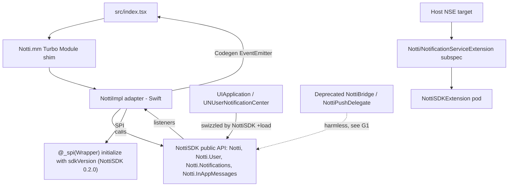

# iOS on the Native SDK Design

**Spec**: `.specs/features/ios-native-sdk/spec.md`
**Context**: `.specs/features/ios-native-sdk/context.md` (G1-G4, decided 2026-10-31)
**Status**: Approved (Julio, 2026-10-31)

---

## Architecture Overview

The Obj-C++ shim (`ios/Notti.mm`, AD-002) stays as the Turbo Module. `NottiImpl` shrinks from an owner
of the core to an adapter: it maps each Codegen call to the `NottiSDK` public API and maps SDK listener
callbacks to the Codegen event emitters. Everything below the adapter (HTTP, queues, stores, swizzling,
In-App engine and UI, privacy manifest) comes from the `NottiSDK` pod.

---

## Spike results (2026-10-31, branch `spike/ios-native-sdk`)

Setup: `Notti.podspec` Core depends on `NottiSDK` 0.1.0 (trunk); the NSE subspec ships one file,
`@_exported import NottiSDKExtension`, and depends on `NottiSDKExtension` 0.1.0; a compile-only Swift
file in module `Notti` calls `Notti.initialize(...)`, `NottiSDK.Notti.User.addTags`, listeners and
`NottiSDK.Notti.logout()`. The old core stays compiled next to it (coexistence is part of the check).
The example NSE target keeps `import Notti` unchanged.

| Linkage | `pod install` | Simulator build (app + NSE) | Notes |
| --- | --- | --- | --- |
| static libraries (default) | OK, resolves `NottiSDK`/`NottiSDKExtension` 0.1.0 from the trunk | **Succeeded** | NSE keeps `import Notti` through the re-export |
| `use_frameworks! :linkage => :static` | OK | **Succeeded** after the `Notti.mm` fix below | |
| `use_frameworks! :linkage => :dynamic` | OK | **Succeeded** after the `Notti.mm` fix below | |

Findings:

1. **`NottiSDK.Notti` does not compile** (`error: type 'NottiSDK' has no member 'Notti'`). The facade's
   Obj-C class is registered as `NottiSDK` (iOS SDK AD-021), and the Clang importer exposes it as a type
   that shadows the module name. Unqualified `Notti` resolves to the SDK facade inside RN's module `Notti`
   in all three linkages. Rule for the adapter: never module-qualify. Report to the iOS SDK repo: any Swift
   CocoaPods consumer hits this when qualifying.
2. **Pre-existing bug in 0.8.0, unrelated to this feature**: the baseline (`main` at `291d5a7`, no spike
   changes) fails with `use_frameworks! :linkage => :static` at `ios/Notti.mm:2:9: fatal error:
   'Notti-Swift.h' file not found`. Frameworks expose the header as `<Notti/Notti-Swift.h>`. Fix used in
   the spike: `#if __has_include(<Notti/Notti-Swift.h>)` import, else the quoted form. CI never builds
   with `use_frameworks!`, which is why it shipped. Apps with Firebase iOS or Expo `useFrameworks` cannot
   build 0.8.0 on iOS.
3. **Pre-existing warnings, also in the baseline**: `Multiple targets match implicit dependency for linker
   flags '-framework Notti'` and `'Notti' is missing a dependency on 'Notti-NotificationServiceExtension'`.
   CocoaPods builds the Core and NSE subspecs as two targets that both produce module `Notti`. Not caused
   by the alias; it does not fail any build. Kept as a known limitation (renaming the NSE subspec module
   would break `import Notti`, contradicting G2).
4. Old core and `NottiSDK` linked together build in all three linkages: no Obj-C class name clash
   (RN registers `NottiBridge`, `NottiImpl`, `NottiPushDelegate`; the SDK does not).

Not covered by the spike (needs a booted simulator or a device, and `NottiSDK` 0.2.0): `+load` running
at launch in each linkage, swizzling together with the deprecated symbols, the SPI hook. The local
simulator runtime is unusable (`CoreSimulator is out of date. Current version (1174.9.2) is older than
build version (1174.21.0)`), so only builds were checked.

---

## Code Reuse Analysis

| Component | Location | How to use |
| --- | --- | --- |
| Turbo Module shim | `ios/Notti.mm` | Kept; same selectors, delegates to the adapter |
| Codegen spec | `src/NativeNotti.ts` | Unchanged (no JS API change) |
| `NottiSDK` public API | `zeep-notti-ios-sdk/Sources/NottiSDK/Public/` | Every adapter call |
| `NottiSDK` manual forwarding | `Notti.Notifications.didRegisterForRemoteNotifications(deviceToken:)` etc. | Target of deprecated `NottiBridge`; ignored with one `.warn` while swizzling is active (SDK DEL-09) |
| `NottiSDKExtension` | pod | Behind the NSE alias subspec |
| Existing XCTest scheme | `NottiTests` | Kept; suites replaced by adapter tests |

**Deleted** (logic now in `NottiSDK`): `NottiApiClient`, `NottiCore`, `NottiDeviceStore`,
`NottiEventBuffer`, `NottiEventStore`, `NottiInApp*` (10 files), `NottiNetworkObserver`,
`NottiNotificationParsing`, `NottiPushPermissionAction`, `ios/PrivacyInfo.xcprivacy`,
`ios/NotificationServiceExtension/` and every matching suite in `ios/Tests/` (NSDK-01, NSDK-19, NSDK-21).

---

## Components

### NottiImpl (adapter)

- **Purpose**: map the Codegen spec to `NottiSDK` and SDK events to Codegen emitters. No business logic.
- **Location**: `ios/NottiImpl.swift` (rewritten), plus `ios/NottiNativeSDK.swift` (seam for tests).
- **Interfaces** (unchanged Obj-C selectors used by `Notti.mm`):
  - `initialize(_:clientKey:baseUrl:sdkVersion:)` calls the SPI initialize
    `initialize(appId:clientKey:options:sdkName:sdkVersion:)` with
    `Options(baseUrl: baseUrl, opensInAppURLs: false)`, `sdkName: "react-native"` and `sdkVersion`
    (NSDK-03, NSDK-04). `sdk_name` is new in NottiSDK 0.2.0 (AD-024 there, after backend AD-044): the
    backend judges `push_permission` In-App eligibility per SDK, and an RN app must not report `ios`.
  - `login`, `logout`, `addTags`, `removeTags`, `setSubscription`, `setLocationSharingEnabled`,
    `setEmail`, `clearEmail`, `setPhone`, `clearPhone`, `trackEvent`: one-line forwards (NSDK-02).
  - `getDeviceId() -> String?` returns `Notti.deviceId`.
  - `requestPermission(resolve)` wraps `Notti.Notifications.requestPermission(completion:)`.
  - `takeInitialNotificationClick() -> [String: Any]?` (NSDK-07, see Initial click below).
  - `activate()` / `invalidate()` attach and remove SDK listeners (NSDK-06).
  - Emit handlers (`emitReceivedHandler`, `emitClickedHandler`, `emitDeviceIdChangedHandler`,
    `emitInAppClickHandler`) set by `Notti.mm`, as today.
- **Dependencies**: `NottiNativeSDK` (protocol; production implementation calls the static
  `Notti.*` API; tests inject a fake).
- **Reuses**: payload-to-dictionary mapping already used by 0.8.0 for `NotificationPayload`
  (`title`, `body`, `data`) and `InAppClickPayload` (`messageId`, `buttonId`, `action {type, value}` or
  null).

### Event bridging and the initial click

Facts from the code (not assumptions):

- `NottiSDK` buffers received and clicked events while no listener is attached and replays them to the
  first listener (`NottiListenerHub`). `takeInitialClick()` returns "the latest tap that arrived while no
  clicked listener was attached, once; nil when a listener already received it".
- 0.8.0 deliberately does **not** replay a buffered click to the JS emitter: the emitter is wired while
  the bundle evaluates, before any `useEffect` subscribes, so a replayed cold-start click was lost. It is
  kept for `getInitialNotificationClick()` instead (`NottiEventBuffer` doc). Received events are replayed.

Design:

1. On `activate()`, the adapter first calls `Notti.Notifications.takeInitialClick()` and stores the
   result in a process-wide slot (survives RN reloads, consumed once), then adds its clicked listener.
   The SDK therefore has no buffered click to replay into a JS emitter nobody listens to yet.
2. `getInitialNotificationClick()` returns and clears the slot; when empty it calls
   `takeInitialClick()` again (covers a tap stored after a reload that removed the listener).
3. Received, device id and In-App click listeners are added on `activate()`; the SDK's replay of
   buffered received events matches 0.8.0.
4. `invalidate()` removes every `NottiSubscription` it holds. Between invalidate and the next
   `activate()` the SDK buffers again.
5. Order must be "take, then add" on the same thread; Tasks adds a test with the fake facade, and the
   cold-start check runs on a device (spec success criteria).

### Deprecated `NottiBridge` and `NottiPushDelegate` (G1)

- **Purpose**: keep 0.8.0 `AppDelegate` code compiling without double processing (NSDK-12).
- **Location**: `ios/NottiLegacyIntegration.swift`.
- `NottiBridge.didRegisterForRemoteNotifications(deviceToken:)` and
  `didFailToRegisterForRemoteNotifications(_:)` forward to the SDK's manual API. With swizzling on, the
  SDK ignores them with one `.warn` (DEL-09); with swizzling turned off by the integrator they still
  work. Marked `@available(*, deprecated, message:)`.
- `NottiPushDelegate.shared`: an `NSObject, UNUserNotificationCenterDelegate` that reports nothing.
  When assigned as the center delegate, the SDK swizzles its class (`setDelegate:` swizzle) and reports
  each callback once; this object then only completes: `willPresent` with
  `[.banner, .list, .sound, .badge]` (0.8.0 behavior for every notification, so an app that keeps the
  line sees no presentation change) and `didReceive` with `completionHandler()`. Deprecated.
- Apps that remove the line get the SDK rule (AD-010 D2): only Notti pushes are presented in the
  foreground, with the same options. Upgrade note.

### NSE alias subspec (G2)

- `ios/NotificationServiceExtension/NottiNotificationServiceExtension.swift` is replaced by
  `@_exported import NottiSDKExtension` so `import Notti` keeps working in the NSE target (spike result
  decides; if the re-export fails in a linkage, the upgrade note asks for `import NottiSDKExtension`).
- `nse.dependency "NottiSDKExtension"`; no React, no `NottiSDK` (SDK AD-012).
- `@_exported` is underscored but has been stable for years and is used by many pods. [Provável]
  acceptable; the fallback is the import change.

### Shim header import

`ios/Notti.mm` imports the generated header with `__has_include(<Notti/Notti-Swift.h>)` first (spike
finding 2). CI gets two extra iOS build legs with `USE_FRAMEWORKS=static` and `USE_FRAMEWORKS=dynamic`
(the example Podfile already reads that variable), so a framework build regression fails CI (NSDK-16).

### Podspec

- Core: `core.dependency "NottiSDK", "~> 0.2.0"` (patch updates only, since the SDK is pre-1.0 and a
  minor may change behavior; each RN release picks the SDK minor on purpose). Source files: `Notti.mm`,
  `Notti.h`, adapter Swift files. `resource_bundles` removed (SDK ships its manifest, NSDK-21).
  `frameworks = "CoreLocation"` removed (the SDK declares its own).
- NSE subspec: alias as above; its `test_spec` goes away (tests live in the SDK).

### Expo config plugin

- No `AppDelegate` work (swizzling).
- No Podfile `source` line needed while `NottiSDK` 0.2.x is on the trunk (G3). The hook for injecting
  `source 'https://github.com/zeeplabs/specs.git'` is deferred to the first post-trunk SDK release.
- Unchanged: entitlements, NSE target (if the plugin creates one) keeps `pod 'Notti/NotificationServiceExtension'`.

---

## Data continuity (NSDK-08..10)

Key audit done on the code (2026-10-31): the 34 persisted `notti_*` keys written by RN 0.8.0
(`grep '"notti_[a-z_]+"' ios/*.swift`) and by `NottiSDK` 0.1.0 (`Sources/`) are the **same set**, in the
same suite `notti_prefs`. No migration code is needed. Codable schemas of the queues
(`notti_pending_events`, `notti_pending_inapp_events`) were ported 1:1 (SDK AD-007/AD-019); the device
check D20 proves it end to end.

`notti_last_synced_sdk_version` will hold the RN version, so the first launch after the upgrade sends one
profile PATCH with the new `sdk_version` (expected, same as any RN upgrade). NottiSDK 0.2.0 adds one key,
`notti_last_synced_sdk_name`, absent after the upgrade, so `sdk_name: "react-native"` is sent once
(additive; the 34 RN keys keep their meaning).

The seam protocol is `NottiNativeSDK`, not `NottiSDKFacade`: NottiSDK 0.2.0 registers its Obj-C facade
class as `NottiSDKFacade` (AD-023 there), visible to Swift through CocoaPods.

---

## Error Handling Strategy

| Scenario | Handling | Integrator impact |
| --- | --- | --- |
| Identity call before `initialize` | SDK logs a warning and keeps 0.8.0 queueing semantics (SDK AD-021) | One log line; upgrade note |
| `initialize` with invalid values | SDK logs without values and ignores | Same as 0.8.0 |
| `pod install` cannot resolve `NottiSDK` | CocoaPods error | README names the required version |
| Integrator keeps 0.8.0 `AppDelegate` lines | Deprecation warnings at build; one SDK `.warn` per forwarded call | Remove lines (upgrade note) |
| Integrator disabled swizzling via Info.plist | Deprecated `NottiBridge` forwards to manual API | Works; documented as advanced path |

---

## Tech Decisions

| Decision | Choice | Rationale |
| --- | --- | --- |
| Test seam | `NottiNativeSDK` protocol around the static API | Static `Notti.*` cannot be faked; L-001: test the adapter's own mapping/lifecycle, SDK behavior is tested in the SDK |
| SDK version pin | `~> 0.2.0` | Pre-1.0 minors may change behavior; RN opts in per release |
| Initial click | take-then-listen, process-wide slot | Keeps 0.8.0's "no replay into an unsubscribed emitter" |
| Legacy delegate | completes only, never reports | SDK swizzles assigned delegates; reporting here would double count |
| Release | 0.9.0 with `BREAKING CHANGE` | `AppDelegate` step removed, possible NSE import change, foreground presentation rule |

---

## Prerequisite outside this repo

`zeep-notti-ios-sdk` 0.2.0: `@_spi(Wrapper)` initialize with `sdkVersion` (G4), tagged and pushed to the
trunk for `NottiSDK` and `NottiSDKExtension` before the cutoff (G3). Its own spec lives in that repo.
Until it exists, this repo can be implemented against a `:path` pod in the example Podfile.
